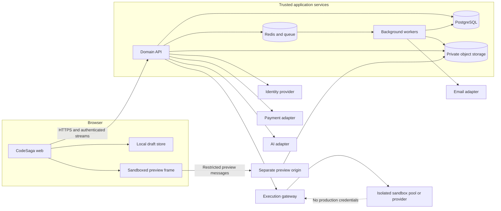
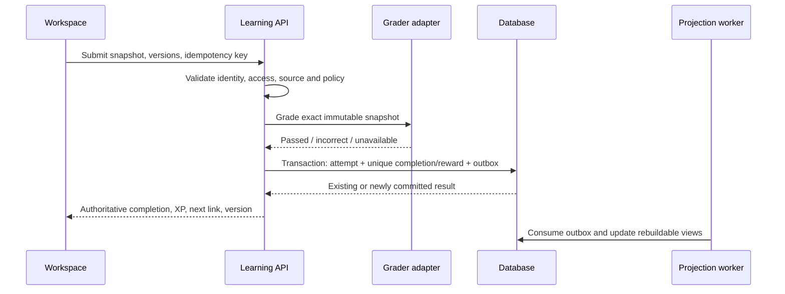

# CodeSaga — Frontend and backend architecture

**Status:** M01 foundation implementation is in progress. Existing scaffold files and commands are listed in [README.md](../README.md); verified outcomes are tracked in the roadmap. The user confirmed the core Next.js frontend and NestJS/PostgreSQL backend on 2026-10-20 Manila; see [PRODUCT.md](../PRODUCT.md). Hosting remains undecided. Domain modules, learner features, external providers and services beyond the foundation below remain proposed designs.

The [roadmap](ROADMAP.md) owns scope, sequence and acceptance outcomes. This document owns the proposed technical boundaries, contracts and data flows. [Context](CONTEXT.md) routes readers to the right evidence. The original [research mapper](../re/README.md) owns reference observations; no architecture here is presented as recovered private Codédex source.

## Contents

1. [Design basis](#1-design-basis)
2. [Recommended platform](#2-recommended-platform)
3. [System overview](#3-system-overview)
4. [Frontend architecture](#4-frontend-architecture)
5. [Backend architecture](#5-backend-architecture)
6. [Data ownership and model](#6-data-ownership-and-model)
7. [API and event contracts](#7-api-and-event-contracts)
8. [Critical data flows](#8-critical-data-flows)
9. [Execution and preview isolation](#9-execution-and-preview-isolation)
10. [Authorization and privacy](#10-authorization-and-privacy)
11. [Operations and verification](#11-operations-and-verification)
12. [Decision register](#12-decision-register)

## 1. Design basis

| Evidence | Architectural consequence for CodeSaga |
|---|---|
| [Run and Submit differ](../re/docs/04-learning-editor-runtime.md); source can pass without a preceding Run | Model execution, grading and completion separately; bind attempts to source/content versions |
| [Python input/error recovery](../re/docs/12-additional-editor-runtimes.md) and [multiple successful runtimes](../re/docs/16-build-progress-and-runtime-verification.md) | Use runtime adapters and typed output events; a compiler banner or output frame is not final success |
| [Authenticated progress/XP](../re/docs/16-build-progress-and-runtime-verification.md) survives same-browser reload | Restore explicit progress and resume projections; add authoritative transactions and cross-session tests in CodeSaga |
| [Build save/version/worker code](../re/docs/13-deeper-client-traces.md), [owner lifecycle](../re/docs/16-build-progress-and-runtime-verification.md) | Version writes; preserve local drafts; model saved source, transient terminal output, preview and publication independently |
| [Mobile panes and visual measurements](../re/docs/05-visual-interaction-system.md) | A shared workspace controller survives pane switches; original pixel art can coexist with readable text and accessible controls |
| [Mixed content shapes and 26 configured course families](../re/docs/02-routes-content.md) | Stable internal IDs; typed/versioned content; multiple lesson types; authoring and publishing validation |
| [Free account, settings and AI allowance UI](../re/docs/15-signed-in-account-investigation.md) | Separate identity, public profile, private preferences, entitlements and quota state |
| [Private/backend gaps](../re/docs/09-coverage-and-open-questions.md) | Choose explicit CodeSaga policies; do not invent target billing, pet timing, moderation or authorization behavior |

The target's Firebase, Redux, STOMP, route names and minified modules are reference mechanisms. They do not require CodeSaga to share the same stack. Target bugs and inaccessible states are documented reference findings, not intended CodeSaga behavior.

## 2. Recommended platform

### 2.0 Foundation decisions — 2026-10-20

Selected under the user's explicit authorization to execute the roadmap:

- **First alpha scope:** original, English-language beginner content: one coherent Python chapter and one HTML/CSS lesson, with discovery → sign-in → real Run/Check → durable progress/resume as the release gate. Builds, community, commerce, AI, pets and extended roles remain later milestones; they are not advertised as available by the scaffold.
- **Content and visual rights:** author CodeSaga curriculum and fixtures; use original pixel-inspired adventure visuals confirmed by the user. Do not distribute captured target artwork, prose or user records. Current database seed content is a draft for infrastructure verification.
- **D01 local baseline:** pnpm workspace with `apps/web`, `apps/api` and `packages/contracts`; Next.js 16.4.2, React 19.3.1, NestJS 11.2.7, TypeScript 5.9.3, Zod 4.6.7 and pg 8.23.1 are exact direct dependency pins. Node.js 24 LTS is the CI baseline; the development host has Node.js 26.10.0. NestJS 11 and TypeScript 5.9 keep conventional decorator compilation for this slice; upgrades require the same build and HTTP checks. Lockfile and manifests own exact dependency versions.
- **Data access:** explicit SQL migrations with `pg`, transaction-scoped advisory locking and a checksum ledger. Digests canonicalize CRLF to LF; equivalent legacy CRLF digests from the first local fixture remain accepted without rewriting the ledger. Changed SQL still fails. This keeps constraints visible and avoids selecting an ORM before domain needs are known. Public Zod transport schemas are shared; database rows and credentials stay in the API.
- **Local services:** PostgreSQL 18.6, Redis 8.10.2 and source-built MinIO `RELEASE.2025-10-15T17-29-55Z` are disposable, loopback-bound Compose fixtures. The MinIO source release is built because its official release does not publish that container tag. Queue and object application consumers remain deferred until needed.
- **D02/D03:** the user has no identity or execution provider yet and requested adapters plus an explicit report of configuration needs. No placeholder sign-in, local execution of learner code or simulated successful Run is an acceptable substitute. Provider choice, credentials, limits and independent-session checks gate M03/M04 respectively.
- **Explicitly deferred:** hosting, production Redis/object vendors, identity/email, execution, billing and AI providers; no commercial account, subscription or deployment is created by local setup. Preview and runner trust zones remain separate from web/API.

Compatibility and API references: [Next.js installation](https://nextjs.org/docs/app/getting-started/installation), [NestJS modules](https://docs.nestjs.com/modules), [Node.js release lifecycle](https://nodejs.org/en/about/previous-releases), [pnpm build allowlist](https://pnpm.io/settings/build#allowbuilds), and [MinIO source release](https://github.com/minio/minio/releases/tag/RELEASE.2025-10-15T17-29-55Z). These explain technology requirements; the roadmap owns actual verification results.

### 2.1 Baseline to review at M01

Use a **TypeScript monorepo**, a separately deployed web application and API, and a backend organized as a modular monolith. Keep job workers and untrusted execution outside the web/API process. This gives the frontend/backend split requested while keeping initial domain transactions manageable.

| Layer | Selected core / proposed supporting baseline | Reason and boundary |
|---|---|---|
| Web | React + Next.js App Router + TypeScript | Public content rendered on the server; interactive lesson/Build islands run in the browser |
| UI | CSS custom properties, scoped styles, accessible primitives, original CodeSaga assets | Semantic tokens and shared components; no archived target assets in production |
| Editor/terminal | Monaco adapter and terminal adapter, loaded on workspace routes | Editor model is accessed through explicit read/write operations; transcript also available as accessible text |
| Browser previews | Separate web/React preview adapters; SQL WASM adapter | Each has its own lifecycle and isolation profile; React library/provider selected after a bounded prototype |
| API | NestJS + TypeScript; REST for commands/queries | Feature modules own business rules; controllers do not become the domain layer |
| Database | PostgreSQL with migrations and a typed data-access layer | Transactions, uniqueness and referential integrity for completion, rewards, ownership and billing |
| Queue/cache | Redis + BullMQ for retryable background work and ephemeral limits | Database remains authoritative; Redis outage must not erase durable rewards or payment events |
| Object storage | S3-compatible private storage with restricted upload/download URLs | Build assets, project media, authored assets and generated certificates have explicit access policies |
| Realtime | Authenticated WebSocket channel for interactive runs/presence; SSE where one-way streams suffice | Public API shape independent of the chosen runner or AI provider |
| Identity | Established identity/session provider behind an adapter | Google/GitHub/email baseline proposed; provider and account-linking policy unresolved |
| Execution | Managed sandbox provider or separately operated sandbox pool behind a gateway | No submitted code runs in API, web or general background workers |
| Search | Database-backed catalog/content search first | Dedicated search service only if measured needs justify it; permission filtering always required |
| Verification | Unit/domain tests, PostgreSQL integration tests, browser E2E/accessibility tests | Frameworks and versions selected and pinned during scaffold; no runnable commands exist yet |
| Local/infrastructure | Reproducible service configuration, environment schema, CI and managed secrets | Separate dev/staging/production identities and buckets; hosting vendors not selected |

The server/client rendering split is supported by [Next.js documentation](https://nextjs.org/docs/app/getting-started/server-and-client-components). Feature module organization is described in [NestJS modules](https://docs.nestjs.com/modules). PostgreSQL supports the proposed key/uniqueness constraints in its [constraint documentation](https://www.postgresql.org/docs/current/ddl-constraints.html). [BullMQ workers](https://docs.bullmq.io/guide/workers) process queue jobs; job idempotency remains an application responsibility. These references explain technology capabilities, not a deployed CodeSaga configuration.

Select supported versions, ORM/query tooling, editor packages and commercial providers when implementation begins; record the actual lockfile and deployment requirements. Do not copy versions from target bundles or label this table the current stack.

### 2.2 Proposed repository layout

```text
apps/
  web/                    Public site and signed-in learner interface
  api/                    Authenticated domain API and stream gateway
  worker/                 Outbox, projections, notifications and scheduled jobs
  preview/                Preview delivery host with no account session
packages/
  ui/                     Tokens, primitives and common presentation components
  contracts/              Public schemas, event envelopes and generated client types
  content/                Authored content schemas, loaders and publishing validation
  runtime-adapters/       Execution/preview adapter contracts and client adapters
  config/                 Shared lint/type/environment configuration
infra/                    Service definitions, migrations/deployment configuration
tests/                    Cross-application journeys and fixtures
docs/                     Context, roadmap and this architecture
re/                       Existing local evidence; ignored by Git
```

Paths above are planned; they do not exist yet. Backend domain modules live inside `apps/api` initially. Add shared packages only when there is a real consumer; avoid exporting database entities through `packages/contracts`. Sandbox workers may require an independent repository/deployment if their trust boundary cannot be represented safely inside this monorepo.

## 3. System overview



The preview and execution services have distinct policies. Static web preview, React compilation, read-only SQL examples and general Python/C#/Java execution are not interchangeable environments. A later Worlds room service is also separate from business API workers.

### Dependency direction

Frontend routes → feature controllers → contract client/adapters → API. Backend transport → application service → domain rules/repository → database or provider adapter. Domain modules exchange explicit services/events; they do not write each other's tables opportunistically. Workers call the same application services for invariants rather than duplicating award/billing logic.

## 4. Frontend architecture

### 4.1 Route families

CodeSaga route names below are proposals, not exact target compatibility promises. Maintain aliases deliberately if a later migration needs them.

| Area | Proposed routes | Rendering/auth boundary |
|---|---|---|
| Public discovery | `/`, `/courses`, `/courses/[courseSlug]`, `/pricing`, `/about`, `/blog`, `/blog/[slug]` | Public, indexable; private progress overlaid through an authenticated query |
| Learning | `/learn/[courseSlug]/[lessonSlug]`, course resources/projects/certificate tracker | Content access resolved before returning protected lesson/check data |
| Practice | `/practice`, `/practice/packs/[slug]`, `/practice/challenges/[slug]`, `/daily` | Public metadata; attempts and daily scoring scoped to principal |
| Home/account | `/home`, `/account/profile`, `/account/billing`, `/account/notifications`, `/account/settings` | Signed-in; no shared public cache |
| Builds | `/builds`, `/builds/[id]`, `/u/[handle]/builds/[slug]` | Owner dashboard versus policy-controlled viewer/remix routes |
| Projects | `/projects`, `/projects/tutorials/[slug]`, `/showcase/[id]` | Tutorials and approved showcase public; drafts private |
| Social | `/community`, `/community/[channel]`, `/community/posts/[id]`, `/u/[handle]`, `/leaderboards`, `/bookmarks` | Explicit visibility and pagination; bookmarks private |
| AI/habits | `/assistant`, `/assistant/[conversationId]`, `/30-nights`, `/30-nights/[runId]` | Conversation ownership and pet visibility policies |
| Extended roles | `/schools/[organizationId]`, educator assignments, `/worlds`, scoped `/admin/*` | Feature flag plus server role/membership checks |

Unknown and unauthorized resources produce distinct product states without revealing private existence unnecessarily. No generic upsell fallback with an invented course/lesson URL. SEO canonicals, redirects and sitemap entries come from published content identities.

### 4.2 Feature ownership

| Frontend feature | Owns | Consumes |
|---|---|---|
| Shell/navigation | Marketing/learner shells, course switcher, search, theme, breadcrumbs | Session summary, catalog metadata, unread count |
| Catalog/content | Filters, curated journeys, cards, resource/article rendering | Published content API; no direct database writes |
| Learning workspace | Instruction/source/output panes, help, files, navigation | Workspace controller, runtime adapters, grading/progress API |
| Progress/dashboard | Resume, XP/level/badges, course/chapter summaries, tracker | Server projections and pending-save state |
| Builds | File tree, assets, source, save conflicts, preview, owner/viewer UI | Versioned Build contracts and execution/preview adapters |
| Practice/projects | Challenge runner, daily state, tutorial navigation, submissions/review status | Content, grading, project and credential services |
| Community/profile | Feeds, editor, moderation/report UI, reactions, follows, portfolio | Sanitized DTOs with explicit capabilities |
| Account/commerce | Profile forms, preference forms, upgrade/portal, entitlements | Private account API and hosted billing adapter |
| AI/habits/roles | Conversations, quota UI, pet tracker, school/Worlds views | Corresponding domain APIs; disabled when feature is unavailable |

Shared UI holds presentation primitives, not course or billing rules. Shared contracts carry serializable DTOs. A component cannot import server credentials, repositories or sandbox management code.

### 4.3 State ownership and hydration

| State | Authority | Frontend treatment |
|---|---|---|
| Published curriculum | Versioned content service | Cache by content version; invalidate after publish |
| Session/permissions | Server session and capability response | No local paid/admin boolean as authority; clear user-scoped caches on account changes |
| XP/completion/resume | Server ledger/projections | Query cache plus explicit pending mutations; never manufacture persisted success |
| Editor draft | Workspace controller and local recovery store | Key by principal/workspace/content version/file; restore after server load/conflict comparison |
| Saved Build revision | API/database | Track base version and dirty draft separately |
| Run output/job state | Active execution job | Sequence events; discard obsolete job output; transcript retention bounded |
| Preview files/status | Current workspace snapshot and preview adapter | Revision-tag messages and acknowledgements; request full resync on mismatch |
| Theme/sound/pane/layout | Local preferences with optional account sync | Safe storage fallback; no secret or sensitive model cache |
| Conversation stream | API conversation plus active stream | Distinguish partial text, saved message and cancelled/failed response |

Initial server content, delayed account hydration and source loading must not briefly become writable empty drafts. Render `loading` rather than a false 0 XP or blank authoritative file. Restore dirty source only after principal/content identity is confirmed. A stale response cannot replace newer data.

Use one query-cache mechanism and feature-local controllers initially. Decide the specific state libraries during scaffold; a global Redux-like store is not required just because the reference has one. Persist recoverable drafts in IndexedDB where appropriate, with a schema version, byte budget, expiry and user-visible discard/export option. Storage failure is recoverable.

### 4.4 Workspace controller and runtime adapter contract

The lesson and Build workspaces share file, editor, output and run primitives, with distinct persistence/grading policies. Their controller exposes:

| Concern | Contract |
|---|---|
| Identity | Workspace ID, principal scope, lesson/content version or Build/base revision |
| Files | Normalized path, language, source, read-only flag, revision/digest; active-file selection |
| Editor | Load model, read current snapshot, apply edit/replace, flush, focus, dispose; no hidden-textarea assumptions |
| Persistence | Dirty/saving/saved/conflict/failed state; expected version; retry/export/discard actions |
| Execution | Start(snapshot), sendInput(jobId), cancel(jobId), stream events, reset output |
| Preview | Mount(snapshot), patch(base,next), resync(snapshot), refresh, error state, dispose |
| Grading | Submit immutable snapshot, receive checking/passed/incorrect/unavailable and feedback |
| Completion | Apply authoritative result/projection version; route to authorized next content |

Proposed states:

```text
Source:     loading -> clean -> dirty -> saving -> saved
                                      -> conflict / failed / denied / quota-exceeded
Run:        idle -> queued -> starting -> running <-> waiting-input
                                  -> succeeded / errored / timed-out / cancelled / lost
Grade:      idle -> checking -> passed / incorrect / unavailable
Preview:    booting -> ready -> updating -> ready
                       -> resyncing / stale / unavailable
Completion: incomplete -> completed; review and certificate states are separate
```

Editing during a run either leaves that run bound to its old immutable snapshot or starts an explicitly new run; it never silently changes an in-flight job's source. Completed lessons remain completed after an experimental failed rerun unless a deliberate content-version policy requires revalidation.

### 4.5 Runtime families

| Family | UI/output | Proposed execution boundary |
|---|---|---|
| Python, Java, C++, C#, general server-side JavaScript, Lua | Editor, stdout/stderr transcript, stdin where supported, exit/resource state | Execution gateway with language-specific entry-file/version adapter |
| HTML/CSS/browser JavaScript | File editor, preview, console/network error panel | Credential-free isolated preview origin; restricted message protocol |
| React and dependency-based web projects | Multi-file editor, compile/preview errors, refresh | Sandbox/compiler adapter with pinned template/dependency policy |
| SQL | Query editor, schema/table view, result/error table | Browser worker/WASM for trusted curriculum fixtures; server option if required |
| Command line/Git simulations | Terminal interaction, virtual files/repository, expected state | Controlled educational simulator; no host shell exposure |
| NumPy/Pandas/Matplotlib/ML/Node/p5.js/Phaser | Package-aware runner or web canvas, artifacts/files, possible HTTP preview | Per-family capability manifest; no blanket claim that a generic interpreter supports these |
| Reading/design/AI literacy | Rich lesson, quiz/reflection/project submission | No pretend code runtime where the lesson does not need one |

Every advertised runtime has a tested capability manifest: language/version, entry-file rules, dependencies, stdin, files, network, preview, output limits and grading mode. Unsupported capabilities are explained before Run.

### 4.6 Visual system, content and accessibility

Use original CodeSaga wordmark, characters, scenes, narrative and audio. Preserve the observed interaction density and pixel-inspired visual direction through semantic tokens: canvas/surface/elevation, readable text, muted text, accent/action, focus, success/warning/error, borders, spacing, typography and motion. Decorative fonts remain separate from paragraph/code fonts.

Build primitives for stepped buttons, cards, tabs, menus, dialogs, form fields, progress bars, toasts, resource panels, badges and file/status icons. Components need loading, empty, disabled, denied, error, success and long-content states. Do not copy target contrast, semantic or overflow defects.

Desktop panes scroll independently; mobile Learn/Code/Output tabs reuse the same controller/model. Marketing navigation and workspace layouts can have different breakpoints. Determine breakpoints from CodeSaga content tests, using the reference's measured 768/1024 behavior as evidence rather than a universal constant.

Support keyboard-only operation, visible focus, modal focus containment/return, actual tab semantics, reduced motion, sound controls, image alternatives, readable code and an accessible terminal transcript. Persist pane choice only according to a documented product rule. Test narrow widths, landscape/small height, zoom, long filenames, large output and missing images.

Render authored lessons/blog/tutorials using a constrained block schema. Allowlisted code examples, images, video references, hints, quiz/check definitions, resource links and project prompts must survive versioned publishing. Do not execute arbitrary MDX from public community submissions. Media and user rich text use separate sanitization pipelines.

## 5. Backend architecture

### 5.1 Domain modules and ownership

| Module | Responsibilities | Owned durable records / external boundary |
|---|---|---|
| Identity | Provider exchange, account linking, sessions, verification/recovery, revocation | Account identity links, session references; identity adapter |
| Accounts | Private profile/preferences, exports/deletion workflow | Account, notification/sound preferences, deletion request |
| Profiles | Handle uniqueness, public projection, social links/skills/avatar | Public profile projection and handle history |
| Content | Catalog, curriculum, lesson/challenge versions, resources, publishing | Courses, chapters, content versions, authoring/media references |
| Access | Capability policies, course/content gates, membership roles | Entitlements, role bindings, policy versions |
| Learning | Source snapshots, attempts, grading orchestration, progression policy | Learner source, grade attempts, enrollment and completion |
| Rewards | XP ledger, badge rules, levels, streak policy | Reward entries, badge grants, daily activity references |
| Progress | Dashboard/course/chapter/resume/credential requirements views | Rebuildable projections and projection version |
| Execution | Runtime allowlist, quotas, job ownership, input/cancel/event gateway | Execution jobs and bounded output/artifact references |
| Builds | Ownership, files, revision conflicts, assets/quota, remix lineage | Builds, file revisions/manifests, asset reservations |
| Publishing | Preview sessions, immutable public releases, hostname assignment | Publications, deploy status and host mapping |
| Practice | Pack attempts, daily rotations, scoring and eligibility | Practice completions, daily challenge/version/schedule |
| Projects/Credentials | Submission evidence, review workflow, certificate eligibility/issuance | Submissions, reviews, credentials and verification/revocation records |
| Community | Channels, posts/replies, reactions, bookmarks/follows, reports | Rich documents, relations, moderation state and action audit |
| Discovery | Search, tutorials/blog indexes, featured collections, leaderboard queries | Rebuildable search/statistical projections |
| Billing | Checkout/portal, signed events, reconciliation, entitlement derivation | Customer/subscription/event ledger; payment adapter |
| Assistant | Context assembly, conversations, streaming, allowance reservation/settlement | Conversations/messages, quota reservations/usage; AI adapter |
| Habits/Pets | Daily local-date activity, pet run/evolution/restart policy | Daily logs, pet runs, rule versions and scheduled transitions |
| Notifications | In-app/email delivery, preference filters, deduplication | Notifications, delivery attempts, email subscription state |
| Organizations | School membership, teacher/student permissions, assignments/reports | Organizations, memberships, assignments, scoped learning views |
| Worlds | Lobby/room membership, presence, movement/chat moderation | Optional room configuration and audited moderation; separate room runtime |
| Administration | Content/review/support/moderation surfaces scoped by capability | Delegates to owning modules; audit log, no unrestricted table editor |

Catalog authoring, billing, moderation and educator interfaces can initially be routes in the same web app with server-enforced permissions. They are not public merely because a route bundle exists.

### 5.2 Command execution and transactions

Validate untrusted DTOs at entry, authenticate the principal, authorize the resource/action, load current version, execute domain policy, commit state and outbox records, then return an authoritative result. Include a request ID in logs/errors. Avoid distributed transactions across providers; reconcile external state through durable event records and repeatable state transitions.

The modular API owns transactions across completion/reward/outbox records. The worker owns retry/delivery scheduling, not the correctness of reward amounts. Unique constraints prevent duplicate completion/award/event keys even under concurrent requests. Do not use process memory as the only lock or success record.

### 5.3 Background jobs

| Job family | Durable trigger | Retry/ordering behavior |
|---|---|---|
| Progress/search/leaderboard projection | Transactional outbox event | Deduplicate event ID; compare aggregate version; rebuildable |
| Email/in-app notification | Eligible domain event + preferences | Deduplication key; backoff; delivery status; no duplicate invites |
| Billing reconciliation | Stored provider event or scheduled audit | Verify signature first; handle reordered events; fetch authoritative provider status as required |
| Asset scanning/transformation | Uploaded quarantine object | Pending until validation; bounded work; no public URL before approval |
| Certificate rendering | Approved eligibility/issue transaction | Stable issue ID; retry must not issue another credential |
| Pet/day rollover | Policy-defined date/zone schedule | Idempotent logical day; delayed job cannot advance twice |
| Publication | Immutable saved Build revision | Status/provenance; failed deployment retains prior working release |
| Account deletion/export | Authenticated confirmed request | Audited staged workflow; preserve legally/product-required records by explicit policy |

Queue payloads contain IDs and versions, not reusable auth tokens or entire private account objects. Jobs have timeout, bounded retries, dead-letter inspection and operator replay controls. Replay calls domain services and is logged.

## 6. Data ownership and model

### 6.1 Conventions

Proposed database choices: opaque stable IDs, UTC timestamps for instants, explicit IANA timezone plus local date for day-based rules, canonical slugs separate from IDs, and versioned content/policies. Money uses integer minor units with a currency; no floating-point prices. Public routes use a validated handle/slug projection and cannot select private account fields.

### 6.2 Core schema groups

| Group | Principal entities | Required integrity |
|---|---|---|
| Identity | accounts, identity_links, sessions, role_bindings | Unique provider subject; session revocation; role scope and expiry |
| Profile | profiles, handle_aliases, profile_links, preferences | Case-normalized handle uniqueness; public field allowlist |
| Content | courses, chapters, lesson_versions, challenge_versions, packs, resources, release_manifests | Stable IDs, valid ordered references, immutable published versions |
| Source/attempts | learner_sources, source_snapshots, grade_attempts, execution_jobs | Attempt binds owner, exact source digest, runtime and content/check version |
| Progress | enrollments, completions, reward_ledger, badge_grants, progress_projections | Unique completion/award keys; rebuildable counters; no lost updates |
| Builds | builds, build_revisions, file_manifests, build_assets, storage_reservations, remix_lineage | Owner ACL, revision compare-and-swap, normalized unique paths, transactional quota accounting |
| Publishing | publications, deployment_attempts, host_bindings | Immutable published revision; unique host; no leakage of later drafts |
| Projects | project_submissions, reviews, certificate_requirements, credentials | Review transitions audited; credential verification and revocation |
| Social | channels, posts, replies, reactions, follows, bookmarks, reports, moderation_actions | Unique actor/subject relation; visibility-aware counters and reads |
| Commerce | plans, subscriptions, entitlement_grants, payment_events | Unique provider event; effective-time policy; access derived server-side |
| AI | conversations, messages, usage_reservations, usage_ledger | Conversation ownership; atomic quota reservation; bounded retained context |
| Habits | daily_logs, pet_runs, pet_transitions, streak_projections | One logical day per run/user rule; timezone/rule version recorded |
| Organization/rooms | organizations, memberships, assignments, room_memberships | Tenant-scoped keys and permissions; expiring room presence |
| Operations | outbox, processed_events, delivery_attempts, audit_log | Event identity, retry metadata, append-only sensitive-action history |

Not every entity needs a table on day one. Introduce records with the milestone that owns them. Do not create empty production subsystems just to mirror this inventory.

### 6.3 Important uniqueness/version rules

- Completion: `(principal_id, content_id, award_policy_version)` or another explicitly approved policy key. Content updates must not accidentally re-award XP. Exact revalidation policy is D05.
- Reward: unique `(principal_id, reason, source_id, policy_version)`; a repeated grade request returns the existing award outcome.
- Command idempotency: `(principal_id, operation, idempotency_key)` bound to request digest; reuse with different input is rejected.
- Build write: update only when stored revision equals `expectedVersion`; return conflict/current version without overwriting the submitted draft.
- Publication: points to a saved immutable revision and asset manifest; editing the Build cannot silently change published bytes.
- Usage: reservation and settled usage use stable request IDs; failed/cancelled provider responses follow an explicit charge/refund policy.
- Relation: unique actor/subject/type key; counts derive from valid relations and visibility, not untrusted client increments.
- Payment event: unique provider/event ID; event processing and entitlement changes record a causation reference.

### 6.4 Queries, pagination and retention

Index published course/slug lookups, principal/content completion, owner/updated Build lists, channel/status/time post feeds, unread notifications, job ownership, and provider event lookup. Specify stable cursor ordering with a tie-break ID; totals and cursors must obey the same visibility filter. Explain partial search results when content is unavailable.

Define retention for drafts, job outputs, deleted Builds, private chats, uploads, audit/payment records and account deletion before production. Soft deletion alone is not a full erasure policy. Use staging fixtures to verify lifecycle transitions; the reference account's test Build deletion does not establish backend retention semantics.

## 7. API and event contracts

### 7.1 General conventions

Proposed application API prefix `/api/v1`. These are new CodeSaga contracts, not copied guarantees about the target's lexical endpoint strings.

- JSON commands/queries use schema validation and contract tests; publish OpenAPI or equivalent generated documentation.
- Resource reads return only permitted fields and a version where writes depend on it.
- Mutation successes contain durable identity/version and authoritative state; accepted async work returns a job/status resource.
- Errors contain stable `code`, human-readable `message`, `requestId`, optional field errors, retry guidance and conflict/current version. Never return stack traces or provider secrets to the browser.
- Differentiate unauthenticated, forbidden/unavailable content, not found, validation error, conflict, quota exceeded, throttled and provider unavailable. Exact HTTP semantics are contract-tested.
- Cursor lists return items, next cursor and explicit optional count semantics; avoid counting hidden records.
- Browser account commands use the server session with CSRF/origin protection; provider webhooks use signature validation and separate authentication rules.

### 7.2 Proposed endpoint groups

| Group | Representative contract surface | Important rule |
|---|---|---|
| Identity/account | session exchange/logout; `GET /me`; profile/preferences update; export/deletion requests | No public account DTO; recent authentication for sensitive actions |
| Content | catalog, course map, versioned lesson/resources, published search | Entitlement resolved before protected bodies/checks are returned |
| Learning | source snapshots; grade attempts; completion/progress/dashboard queries | Source digest and content/check version included; duplicate Submit safe |
| Guest migration | preview merge; confirm merge with stable migration ID | No trusting client-supplied XP/completion claims |
| Execution | create job; get status/output; input/cancel; authenticated event channel | Ownership and quota checked on every stream/input/cancel action |
| Builds | list/create/get; save revision; file/asset operations; delete/remix | expectedVersion and capability check; validate paths and sizes |
| Publication | create deployment from saved revision; status; unpublish; host binding | Save does not publish; host ownership and asset ACL verified |
| Practice/projects | packs/challenges/daily, attempt, submission/review/credential verification | Review and score policy explicit and versioned |
| Community | feeds/posts/replies/reactions/follows/bookmarks/reports | Visibility-aware reads and writes, moderation/audit rules |
| Billing | plan display, checkout, customer portal, provider webhook | Browser cannot grant an entitlement; no redirect-based paid success |
| Assistant | conversations/messages, usage, stream/cancel | Atomic quota reservation; context belongs to caller |
| Habits | pet selection/run, daily log, tracker, restart | Day boundary and restart policy enforced server-side |
| Schools/admin | organization-scoped membership/assignments/reports; permitted admin operations | Tenant/role/resource checks for every action |

The full route set is defined when the corresponding milestone ships. The 180 target API strings are an investigation appendix, not a requirement to reproduce legacy, vendor or admin paths verbatim.

### 7.3 Event envelopes

Execution events: `jobId`, monotonically increasing sequence, event type, payload and optional timestamp. Types include queued, started, stdout, stderr, stdin-requested, artifact, resource-update and terminal result. Terminal result carries status and available exit/error/resource metadata. Output is text/data, never trusted HTML.

Domain events: `eventId`, type/version, aggregate ID/version, actor/principal reference, causation/request ID and safe payload. Examples: completion accepted, reward awarded, Build saved/deleted, publication changed, subscription reconciled, review approved and daily activity accepted. Events are delivered at least once; consumers deduplicate and ignore obsolete aggregate versions. Store changes and outbox in one transaction.

Preview messages: protocol version, preview session identity, build/workspace identity, base revision, next revision, manifest/digest and allowlisted operation. Accept messages only from the exact expected origin and frame/channel. Acknowledgement identifies applied revision; gaps request full sync. Do not copy weak origin/path handling from reference worker code.

## 8. Critical data flows

### 8.1 Run

1. Workspace flushes the editor model and freezes files/runtime/source digest.
2. API authenticates/identifies the principal, checks runtime and quota, creates a job and short-lived run capability.
3. Gateway sends the job to a sandbox adapter; events are normalized and sequenced.
4. Browser shows output for that job only; stdin/cancel reference its authenticated capability.
5. A terminal event finalizes resource accounting and UI state. Timeout/disconnect recovery does not automatically create duplicate executions.
6. Run alone never awards completion/XP. Browser-only previews follow their own adapter path and do not pretend to have server exit codes.

### 8.2 Submit and award



A grader transport error is `unavailable`, not success. Correct alternatives, comments-only matches, syntax errors and stale source are evaluated by the selected check mode. Manual/project completion is explicitly identified. Immediate award responses and later projections share a version/correlation so the dashboard does not briefly regress.

### 8.3 Guest-to-account transfer

Local guest drafts/progress are namespaced and versioned. After login, the server previews a merge, validates content references and revalidates eligible completions according to the chosen policy, then commits under a unique migration ID. Existing account completion takes precedence over regression; rewards cannot be client-selected. Copy drafts only after resolving account/source conflicts. Display what transferred and what needs retry. Do not delete local guest recovery data before confirmed success.

This is a proposed CodeSaga workflow; the target's actual migration was not verified.

### 8.4 Build save, run, reload and delete

Load server identity/revision before enabling edits. Overlay a recoverable local draft with a visible conflict choice. Save sends expected revision, normalized files and snapshot digest; server checks ACL/quota and atomically commits a new revision and asset references. A conflict returns metadata without discarding either draft.

Save and run reports save and execution results separately. If saving fails, do not imply source is durable because the terminal ran successfully. Reopen restores saved source; terminal output is transient unless explicitly retained. Returning to the dashboard revalidates the list/count. Deletion is an authorized confirmed action; stale saves/publications cannot resurrect a deleted Build. Blob cleanup is an idempotent job with audit/retention policy.

### 8.5 Publish/remix and project submission

Publish selects an immutable saved revision, verifies publish entitlement/visibility, builds or copies approved assets and assigns a publication identity. Preview and published hosts have separate lifecycles. Remix creates a new owner-scoped Build with explicit permitted lineage; no original private ACL/invite is copied.

A showcase post references a Build/publication or validated external project URL. A course project submission records versioned evidence for review; approval/certificate eligibility is a separate transaction. Editing/deleting the Build after submission follows an explicit evidence-retention policy rather than silently changing the reviewed work.

### 8.6 Billing and entitlements

Server creates checkout for a known plan/currency and authenticated customer. A return URL only shows pending verification. Store signed provider events, deduplicate, reconcile current subscription and derive effective entitlements. Support delayed/reordered events and cancellation with paid-through expiry. Reconciliation repairs missed webhooks. Price, provider and subscription policies remain unresolved product decisions.

### 8.7 AI conversation

Authenticate conversation ownership, reserve quota atomically, construct permitted lesson/source context, call a provider adapter and stream partial output with cancellation. Persist message status and settle/refund usage by documented policy. Reconnect resumes/reconciles the saved message rather than charging a duplicate question. Model display reflects configured service identity; no claim that the reference's UI attribution proves its backend model.

### 8.8 Daily activity, pets and leaderboard

Server resolves the run's policy version, timezone and logical date, validates eligible activity and commits one daily record/transition. Scheduled rollover uses the same policy and cannot double-apply delayed jobs. Streak, pet run and daily challenge are distinct concepts. Leaderboards consume eligible reward/activity records for explicit windows/tie rules. Timezone changes, DST and late activity have policies before a public launch.

## 9. Execution and preview isolation

### 9.1 Trust zones

| Zone | Allowed | Excluded |
|---|---|---|
| Web/API | Trusted UI/application/domain code; narrowly scoped provider calls | Arbitrary learner programs, open shell execution, public compiler process |
| General worker | Notifications/projections/rendering trusted templates | Unrestricted user source execution |
| Code sandbox | Selected runtime, bounded source/data, explicitly allowed artifacts/stdin | Application DB credentials, metadata endpoint access, host mounts, unrestricted network |
| Browser preview | User-generated web output and controlled assets | Account cookies, production origin privilege, access to parent DOM |
| Upload quarantine | Untrusted bytes under validation | Public execution or serving as trusted application script |

Sandbox policy sets wall/CPU time, memory, process count, output bytes, files, disk and network limits. Network defaults off; any lesson-specific exception is explicit. Egress/metadata protections, runtime image provenance, patching, lifecycle cleanup, concurrency and abuse limits are launch requirements. Containerization by itself is not a complete isolation argument.

### 9.2 Preview origin and artifacts

Use a separately registered domain/site boundary for untrusted previews where practical, not merely a path on the authenticated app. Never send account session cookies to that host. Review iframe sandbox permissions and CSP for each runtime; avoid combinations that recover application-origin privilege. Dependencies are pinned/allowlisted and fetched through a controlled policy.

Normalize/validate file paths before every read/write/message; disallow traversal, ambiguous encoding and reserved paths. Enforce correct MIME, asset size/type and cache policy. Service-worker use is optional and versioned; if adopted, scope/caches belong only to preview sessions. Session expiration, worker restart and patch mismatch trigger safe resync. Preview availability is not durable-save confirmation.

SQL fixture databases and simulators reset deterministically and cannot access production data. Generated HTML, terminal output, execution artifacts and AI messages all pass through appropriate rendering rules.

## 10. Authorization and privacy

### 10.1 Capability matrix

| Principal | Allowed baseline | Additional checks |
|---|---|---|
| Guest | Published free metadata/content; bounded guest runtime if offered | Anonymous quota identity; no durable account writes |
| Signed-in Free | Own progress/account/Builds/bookmarks/conversations under limits | Owner ACL and capability/byte/runtime limits |
| Paid member | Purchased effective capabilities | Current server entitlement; plan does not grant moderation/admin |
| Build collaborator | Explicit invited role if collaboration ships | Build-scoped permission, revocation and invite expiry |
| Reviewer/moderator | Assigned review/moderation actions | Separate capability, auditable transition and scope |
| Teacher/student | Organization membership and permitted assignment views | Tenant + class + role; no global learner-data access |
| Administrator/support | Specific operational actions | Least privilege, recent authentication where needed, audited actions |

This matrix is proposed. Do not encode all paid, educator or internal roles as one boolean. UI capabilities improve clarity but never replace server checks. WebSocket connections, messages, files, presigned URLs and worker jobs inherit resource-level authorization.

### 10.2 Session and data safeguards

Use a provider-supported server session strategy with Secure/HttpOnly cookies where applicable, CSRF protection, strict allowed origins, session rotation/revocation and safe return URLs. Do not reproduce a browser-written auth cookie because it appeared in the target. Restrict CORS and secrets to their intended deployment. Logs redact cookies, execution/AI tokens, provider payload secrets and private source where not needed.

Public profile, feed, search, SEO metadata and leaderboard DTOs use allowlists. Email, billing IDs, private source/history and administrative flags never appear in public projections. Media metadata and external links are validated. Reporting, blocking, notification preferences and account deletion/export have documented visibility/retention behavior.

### 10.3 Content rights and source handling

Research artifacts remain reference evidence. CodeSaga content/assets are authored or licensed with provenance. Preserve attribution for third-party packages and materials. Never deploy target Firebase identifiers/credentials, archived user content, target lesson prose, artwork or copied operational endpoints as CodeSaga configuration/content. `re/` remains ignored until the user explicitly changes evidence-distribution policy.

## 11. Operations and verification

### 11.1 Environments and delivery

Development uses reproducible local services and fake/test provider adapters. Staging exercises real isolated provider test environments and seeded users/organizations. Production uses separate secrets/accounts/buckets/domains. Define compatible web/API/worker contract versions, migration order, feature flags, canary/revert procedure and previous-publication rollback.

Migrations are reviewed, repeatable and tested with existing data; destructive changes require a backup/restore path. Outbox/queue deployments support rolling upgrades. Do not expose unfinished paid/role/runtime features merely because routes are bundled.

### 11.2 Observability

Correlate request, principal reference, attempt/job, Build revision, provider event and outbox IDs. Observe save failure/conflicts, grade availability, completion/reward duplicates, projection lag, execution queue/start/end/loss, preview readiness, webhook lag, AI quota/stream failures, job retries and notification delivery. Avoid high-cardinality personal/source text in metric labels.

Keep business audit logs separate from product analytics. Analytics consent/preferences and deletion/export obligations are explicit. Performance/cost monitoring covers editor payload size, runtime provider spend, storage/egress and AI reservations.

### 11.3 Proposed release targets

These are **initial budgets to validate**, not measured capabilities: ordinary cached catalog/dashboard queries p95 under 500 ms in the staging load profile; save acknowledgement p95 under 1 s excluding large uploads; terminal output delivery p95 under 500 ms after gateway receipt; browser workspace interactive within 5 s on the declared mid-tier device/network; zero duplicate XP under concurrency tests. Provider cold starts and compiler time are measured separately and displayed honestly.

Before launch choose traffic/concurrency fixtures, output/storage caps, AI spend limits, backup recovery point/time objectives and support coverage. No invented SLA or unlimited service promise.

### 11.4 Verification by risk

| Layer | Required evidence |
|---|---|
| Domain | Award uniqueness, completion/version transitions, access policy, date rules, quota settlement |
| Database/API | Concurrent submissions, Build revision conflict, owner/tenant denial, webhook replay, outbox retry |
| Runtime | Each advertised language/template: success, errors, stdin, timeout/cancel, output cap, disconnect and cleanup |
| Browser | Guest/account journey, refresh/resume, source preservation, mobile tabs, Build lifecycle, preview update |
| Accessibility/visual | Keyboard/focus/semantics/contrast, responsive workspace, original art loading and reduced motion |
| Privacy/security | Public projection allowlists, cross-account reads/writes, preview origin isolation, uploads and secret redaction |
| Operations | Restore drill, projection rebuild, bad deployment rollback, provider/queue failure and alert ownership |

Use original synthetic CodeSaga fixtures. Target research results supply behavioral reference cases, not a test suite against a production third-party account. Application commands are added to AGENTS only after actual scripts exist.

## 12. Decision register

The core framework/database choice is confirmed in [PRODUCT.md](../PRODUCT.md). Other entries and the remaining parts of D01 are unresolved proposals unless a later decision record changes their status. Product/stack approval does not automatically approve a hosting vendor, supporting provider or spending plan.

| ID | Decision | Proposed default | Decide before |
|---|---|---|---|
| D01 | Stack, repo packages and hosting | Local baseline selected in section 2.0; manifests/lockfile own pins. Hosting and production infrastructure remain deferred | Local verification M01; hosting before deployment |
| D02 | Identity/session/email providers and account linking | User requested adapters; no provider/credentials yet. Established provider, Google/GitHub/email and server session remain proposals | M03 identity |
| D03 | Execution provider, costs and sandbox policy | User requested adapters; no provider/credentials yet. One verified isolated Python path before expansion | M04 live Run |
| D04 | Original brand, assets, curriculum scope/licensing | Pixel-inspired adventure confirmed; original alpha content scope in section 2.0; actual system/assets follow in M02 | M02 public assets/content |
| D05 | Grade, completion, revalidation, XP/level/badge/skip rules | Versioned checks and server award ledger; no XP on skip | M04/M05 accepted attempts |
| D06 | Guest persistence and transfer | Recoverable local drafts; server-validated one-time merge | M03/M05 migration |
| D07 | Free/paid Build/runtime/storage/AI quotas | Configurable capabilities; no target limit copied as a promise | M07 Builds / M10 commerce |
| D08 | Build visibility, remix rights, publication/hostnames | Explicit owner-selected visibility; saving distinct from publishing | M07 create / M08 publish |
| D09 | Project review/certificate/mentor service policy | Separate submission/review/eligibility with verifiable credentials | M09 credentials |
| D10 | Payment provider, currency/tax/refund/cancellation policies | Hosted provider test checkout; verified webhook entitlements | M10 purchases |
| D11 | AI provider/model, context, retention, reservation/refund | Provider-neutral adapter; atomic quota | M11 assistant |
| D12 | Daily challenge/pet/streak timezone, grace/restart and scoring | Explicit versioned logical-day policy | M12 habits |
| D13 | Community roles, conduct/moderation, leaderboard windows | Explicit visibility/action policy and operational owner | M09 social release |
| D14 | Schools and Worlds release scope | Later gated capabilities with their own acceptance/security review | M14 extended roles |
| D15 | Retention/deletion, backups, telemetry and service targets | Document per data class; validate targets in staging | M16 launch |
| D16 | Collaboration, custom domains, external shop and integrations | Deferred until scope/support/ownership justified | Relevant later extension |

Resolve a decision with owner/date, rationale, affected milestones, contract/policy version and verification evidence. Update this register rather than leaving conflicting policies in task notes.
