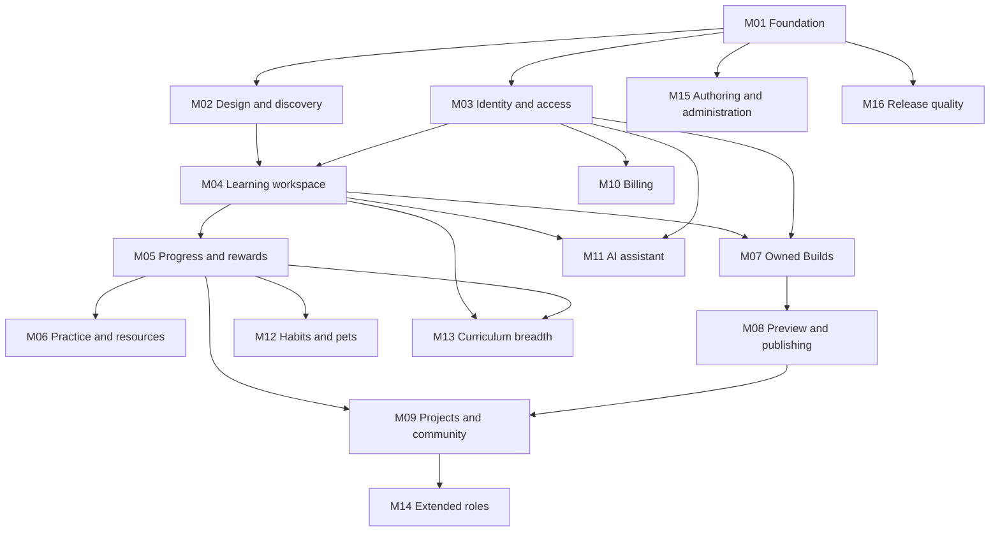

# CodeSaga — Full product roadmap

**Baseline:** 2026-10-20, Asia/Manila. **Application status:** M01 foundation complete. Separate web/API scaffolds, shared schemas, a lockfile and healthy local service fixtures are verified from clean source and Linux CI. Learner features and deployment remain unimplemented; M02 is the next eligible milestone.

**Goal:** an original CodeSaga platform with a complete frontend and backend for discovering courses, learning and executing code, receiving checked feedback, retaining progress/rewards, practicing, building/publishing projects and participating in community, followed by paid assistance, habits and extended roles.

The user explicitly authorized autonomous roadmap execution on 2026-10-20. This delivery sequence does not itself authorize spending, deployments or target-account actions. Read [CONTEXT.md](CONTEXT.md) for navigation, [ARCHITECTURE.md](ARCHITECTURE.md) for boundaries and decisions, and [the investigation mapper](../re/README.md) for observed reference behavior.

## Contents

- [Status rules](#status-rules)
- [Verified starting point](#verified-starting-point)
- [Scope and release order](#scope-and-release-order)
- [Frontend and backend at a glance](#frontend-and-backend-at-a-glance)
- [Milestone dependency map](#milestone-dependency-map)
- [M01 — Foundation](#m01--decisions-and-working-foundation)
- [M02 — Design and discovery](#m02--original-design-system-discovery-and-content-shell)
- [M03 — Identity and access](#m03--identity-accounts-and-access)
- [M04 — Lesson and execution](#m04--complete-lesson-and-execution-experience)
- [M05 — Progress and rewards](#m05--durable-progress-rewards-and-resume)
- [M06 — Practice and resources](#m06--practice-packs-daily-challenges-and-resources)
- [M07 — Owned Builds](#m07--owned-builds-and-durable-files)
- [M08 — Previews and publishing](#m08--previews-sharing-remix-and-publishing)
- [M09 — Projects and community](#m09--projects-credentials-community-and-public-identity)
- [M10 — Billing](#m10--plans-billing-and-effective-entitlements)
- [M11 — AI assistant](#m11--ai-learning-assistant)
- [M12 — Habits and pets](#m12--daily-habits-streaks-and-virtual-pets)
- [M13 — Curriculum breadth](#m13--curriculum-and-runtime-breadth)
- [M14 — Extended roles](#m14--schools-collaboration-and-worlds)
- [M15 — Authoring and administration](#m15--authoring-administration-and-operational-tools)
- [M16 — Launch readiness](#m16--launch-quality-reliability-and-operating-readiness)
- [Full evidence-to-feature coverage](#full-evidence-to-feature-coverage)
- [Unresolved evidence and decision coverage](#unresolved-evidence-and-decision-coverage)
- [Release verification matrix](#release-verification-matrix)
- [Deferred and excluded work](#deferred-and-excluded-work)
- [Status summary and maintenance](#status-summary-and-maintenance)

## Status rules

- `[ ]` = not yet verified as complete. `[x]` = implemented **and verified**.
- **Not started:** no required items verified. **In progress:** some required items pending. **Complete:** all required items verified.
- **Deferred:** intentionally excluded from the current milestone; move it to the Deferred section instead of counting it as done.
- The agent must check actual implementation/tests before marking an item complete; if evidence is missing, leave it unchecked and note the uncertainty.
- Each checkbox should describe an **observable, testable outcome**, not a class name, code snippet, or implementation technique.
- Follow approved priorities; do not assume the next unchecked item is automatically authorized work.

Stable IDs such as M05.03 survive wording changes. Implemented-but-unverified work stays unchecked. Completion needs affected source/contracts, verification results, environment/fixture identity, review/commit references where applicable and remaining limitations. A successful Codédex probe does not prove CodeSaga implements the feature.

## Verified starting point

This table preserves the documentation-only initialization baseline. Subsequent implementation outcomes are recorded under each milestone.

| Item | Verified state | Authority |
|---|---|---|
| Repository | Documentation-only; no app manifests/source or app build/test commands | Repository inspection at initialization |
| Investigation | 17 investigation documents; 58 unique REA records and supporting HTTP/static/visual artifacts | [Research map](../re/README.md), [evidence register](../re/docs/01-evidence-register.md) |
| Signed-in research | 14 initial read-only states plus 44 focused Computer Use states and 23 visual transcriptions | [Account UI](../re/docs/15-signed-in-account-investigation.md), [focused pass](../re/docs/16-build-progress-and-runtime-verification.md) |
| Inventory | 251 route templates, 244 sitemap URLs, 26 configured course definitions, 601 ordinary lesson labels, 13 packs/67 challenges | [Routes/content](../re/docs/02-routes-content.md); configured labels are not all verified published executions |
| Execution | Python run/input/error recovery; JS/SQL/C++/public-class Java results; C# final output and React valid render/edit/restoration | [Runtime expansion](../re/docs/12-additional-editor-runtimes.md), [focused pass](../re/docs/16-build-progress-and-runtime-verification.md) |
| Owner behavior | Temporary Build create/edit/save/run/reload/delete; new lesson completion/+15 XP across same-browser reload/navigation | [Focused pass](../re/docs/16-build-progress-and-runtime-verification.md) |
| Integrity | Latest recorded research audit: 512 JSON files, 235 local links, 836 hash comparisons, no errors | [Archive audit](../re/docs/evidence/archive-audit.json); these counts describe that run |
| Evidence delivery | Existing .gitignore ignores re; evidence is local and not ordinary Git-tracked documentation | [Replay/delivery](../re/docs/11-verification-and-replay.md), root .gitignore |
| Stack/operations | No verified installed CodeSaga stack, provider or deployment | Repository inspection |

Research readiness differs from implementation completion. We have enough evidence to design/build the core. We do not have the target's original backend, database rules, exhaustive paid/teacher/admin behavior or every hidden state.

### Evidence labels

| Label | Meaning | Planning use |
|---|---|---|
| Observed | Captured behavior/selected protocol response | Reference case within its browser/account/time scope |
| Static | Shipped bytes contain a mechanism/field/branch | Design input, not proof of deployed enforcement |
| Proposed | CodeSaga design or product policy | Resolve before dependent behavior ships |
| Unknown | Evidence does not establish behavior | Choose a CodeSaga policy or obtain authorized evidence |

Document 16 resolves earlier React/C# and owner-lifecycle gaps within its scope. It does not retroactively change the original REA probe results or establish cross-device durability.

## Scope and release order

### Included product capabilities

Marketing/discovery; curriculum/content; lesson/editor/runtime/grading; identity/accounts/access; progress/XP/badges/streaks; practice/daily challenges; resources/tutorials/blog/search; Builds/files/assets/preview/publish/remix; course projects/review/certificates; community/profile/leaderboards; billing; AI; virtual pets; notifications; schools; optional multiplayer/collaboration; authoring and operations.

Implement useful product behavior with original CodeSaga content/assets and explicit server policies. Reference defects, legacy experiments and unverified privileged routes are not requirements to reproduce.

| Release slice | Learner-visible outcome | Required scope |
|---|---|---|
| Core learning alpha | Discover original content, sign in, finish a coherent Python chapter/web lesson, retain checked progress and resume | M01–M05 and applicable M15/M16 gates |
| Creator beta | Practice, save/reopen Builds, preview/publish/remix, submit projects and use moderated community | M06–M09 and applicable M15/M16 gates |
| Membership/habits | Purchase verified capabilities, use quota-aware AI, participate in daily/pet journeys | M10–M12 and operational gates |
| Broad learning | Original content across evidenced topic families and tested runtimes | M13 delivered incrementally |
| Extended roles | Approved school/teacher/student and collaboration/Worlds experiences | M14 with role/operating gates |
| Production | Every included slice is verified, recoverable, observable and supportable | M15/M16 per release, not postponed to the end |

These are scope slices, not dates or cost estimates. Staffing, budget, launch date, original content volume and vendors remain unresolved. A smaller approved release can ship while later scope stays planned/deferred.

## Frontend and backend at a glance

| Frontend | Backend | Shared contract |
|---|---|---|
| Responsive shells, catalog, content and original visual system | Published content/catalog and access policies | Stable IDs/versions, DTOs and denied/not-found states |
| Actual editor models, local draft recovery, terminal/preview UI | Execution gateway, isolated jobs, quotas/output streams | Immutable snapshot, job identity, ordering and terminal result |
| Submit feedback/navigation | Versioned grading, completion/reward transaction | Run differs from Submit; authoritative accepted outcome |
| Dashboard/maps/XP/badges/resume | Durable ledger and rebuildable projections | Consistent scopes, versions and pending states |
| Build files/assets/save/conflict/publication UI | Owner ACL, revisioned storage, quotas and immutable releases | Expected revision, conflict, visibility and publication identity |
| Community/account/commerce/AI/pet/role views | Domain permissions, moderation, billing, usage and date policies | Public/private projection, ownership and policy version |

The user confirmed the React/Next.js frontend and NestJS/PostgreSQL backend in [PRODUCT.md](../PRODUCT.md). The core now has pinned scaffold dependencies and local service fixtures. Hosting, production infrastructure and separate runner/preview services remain undecided or unimplemented. Modules, entities, contracts, flows and trust boundaries live in [ARCHITECTURE.md](ARCHITECTURE.md).

## Milestone dependency map

M15/M16 apply throughout. Free capability enforcement belongs to M03 and does not wait for billing. Paid variants cannot launch before M10 integration. Dependencies express prerequisites, not mandatory serial staffing. External-link project submissions can precede Build publishing; school and Worlds subdomains can be released independently.

## M01 — Decisions and working foundation

*Outcome: an agreed technical baseline and reproducible, verifiable starting application.*

**Status:** Complete. **Dependencies:** none. **Evidence:** [reconstruction map](../re/docs/08-codesaga-reconstruction-map.md), source and verification below. **Decisions:** architecture D01–D04.

- [x] **M01.01** First-release scope, original-content strategy and exclusions are recorded; later features are not advertised as shipped.
- [x] **M01.02** Frontend/backend/runtime/data boundaries and initial stack/provider choices have rationale, supported versions and explicit deferred decisions.
- [x] **M01.03** A fresh checkout can install, run, build and verify the real scaffold through documented scripts and a committed lockfile.
- [x] **M01.04** Environment validation fails clearly on missing/invalid settings; examples contain no production secrets or target service credentials.
- [x] **M01.05** Local database/object/queue fixtures and migrations initialize a clean environment reproducibly.
- [x] **M01.06** Public web/API schemas have one authority; invalid requests and known errors return predictable contracts/request IDs.
- [x] **M01.07** CI verifies actual scaffold scripts with isolated fixtures; frontend builds exclude backend secrets and raw research assets.
- [x] **M01.08** Context/AGENTS reflect actual directories, commands and installed versions after scaffold while retaining existing rules.

**Exit evidence:** fresh-checkout results, real package/config paths, migrations/contracts and recorded decisions. Planning alone does not close M01.

**Verified — 2026-10-20:** `apps/web`, `apps/api`, `packages/contracts`, `infra`, real scripts and `pnpm-lock.yaml` exist. A clean Git archive of `71b1d25` passed frozen installation, setup, repeated migration/seed, `pnpm verify` and both cross-process HTTP checks on Windows/Node 26.10.0. Clean-source testing found and fixed CRLF/LF migration digests without permitting changed SQL or rewriting history. Source `90b7c0d` additionally passed production-server acceptance locally and the [complete Linux/Node 24 CI pipeline](https://github.com/edisonmalasan/CodeSaga/actions/runs/39393475067): frozen install, clean services, signed object round-trip, repeat migration/seed, types, unit/HTTP tests, mandatory PostgreSQL integration, builds, secret-canary/production boundary audit, both cross-process checks and cleanup. The earlier CI run was cancelled after passing tests hung during nested-process shutdown; direct server ownership and bounded teardown fixed that failure before this passing run.

Environment cases exercise malformed settings/redaction; HTTP cases cover IDs, CORS, payload bounds, safe errors and outages. Database cases cover concurrent migration, rollback, checksums/line endings, constraints and idempotent original draft seed. PostgreSQL, Redis and MinIO are local fixtures; no deployment, learner account, queue consumer, production object integration or live runner is claimed. Decision rationale and deferred providers are in architecture section 2.0. All later milestones retain their own acceptance gates.

## M02 — Original design system, discovery and content shell

*Outcome: learners discover/read original content through a coherent accessible public interface.*

**Status:** Complete for the original public reading/discovery slice. **Dependencies:** M01 complete. **Evidence:** [routes/content](../re/docs/02-routes-content.md), [visual system](../re/docs/05-visual-interaction-system.md), [public edges](../re/docs/14-public-interaction-edge-cases.md), implementation and verification below. **Decision:** D04 and authored release scope.

- [x] **M02.01** Original CodeSaga branding, pixel-inspired scenes/characters and licensed fonts/media have provenance and readable paragraph/code typography.
- [x] **M02.02** Shared controls cover keyboard focus, loading, empty, disabled, denied, error and success states.
- [x] **M02.03** Marketing/learner shells support desktop/mobile navigation, course switching, breadcrumbs and help/footer links without overlap or inaccessible controls.
- [x] **M02.04** Catalog cards derive category, difficulty, description, prerequisites/recommendations and availability from validated published metadata.
- [x] **M02.05** Text/category filters reset correctly and provide no-results feedback; curated paths have an explicit relationship to filtering.
- [x] **M02.06** Course pages distinguish chapters, lessons, bonus articles, packs, cheat sheets, checkpoint/final projects, certificates and coming-soon sections.
- [x] **M02.07** Stable content IDs/versioned references survive title/slug changes; aliases redirect and invalid/locked resources show accurate identity.
- [x] **M02.08** Rich lesson/article/tutorial blocks support code, images/expansion, safe video, headings, instructions/help and graceful missing-media states.
- [x] **M02.09** Theme/sound/reduced-motion preferences survive navigation as specified and degrade safely when storage fails.
- [x] **M02.10** Metadata, canonicals, sitemap/robots and sharing links reflect published resources; drafts/private records do not enter public indexes.
- [x] **M02.11** About/help/pricing-entry/blog/tutorial/search discovery work with original or licensed content and explicit external/unavailable states.

**Exit evidence:** asset provenance, content validation, responsive/keyboard review, filtering/redirect/metadata and safe-rendering cases.

**Verified — 2026-10-20:** Original published data and relationship validation live in `packages/content`; public transport schemas in `packages/contracts`; NestJS content reads in `apps/api/src/content`; Next.js discovery/reading in `apps/web`. The source-controlled publication slice contains five course entries (two previews, three upcoming), two chapters, four reading lessons and five resources/110 rich blocks. Catalog cards expose their validated prerequisites/recommendations through native disclosures. These are original static reading previews, not a released interactive alpha. [Frontend design](../apps/web/DESIGN.md) and its scoped sidecar record the built system; [asset provenance](../apps/web/ASSETS.md) preserves the original scene prompt and local Silkscreen license.

Types, 36 package unit/HTTP tests and five mandatory PostgreSQL integration tests passed; the ordinary API test invocation's one explicit database skip is covered by the mandatory suite. All 11 production Chromium acceptance cases passed without retries, including all four reading previews at 320/390/768/1024/1440, actual card guidance, filters/reset/read navigation, canonical identities/metadata, preferences/storage failures, keyboard recovery, media failures and sharing. Production builds and boundary audits passed. The [full Linux/Node 24 CI for final application source `16adb34`](https://github.com/edisonmalasan/CodeSaga/actions/runs/39429712809) passed frozen installation, isolated services, signed object round-trip, repeat migration/seed, types, tests, build/secret-canary audit and Chromium acceptance.

Independent full-interface review identified one retry recovery defect; its [verdict pass](../apps/web/.impeccable/review/finish-verdict.md) scored that fix resolved after actual API outage/restoration/retry. The later [catalog extension review](../apps/web/.impeccable/review/cards-review.md) returned **ship** at its scoped level; the documenter confirmed conformance to the incumbent system. Sixteen base/outage captures plus three current catalog captures, exact scope/limitations and detector results are retained in [verification evidence](../apps/web/.impeccable/review/verification.md). JSON/YAML, normative token references and local documentation links were validated. External video playback, subjective audio listening, other browsers/screen readers, identity, execution and durable progress are not certified by this milestone.

## M03 — Identity, accounts and access

**Provider preparation:** Internal identity/session ports and rejecting adapters are implemented and tested; capabilities stay `false/not_configured`, and session lookup returns a typed 503 even with forged credentials. This does not complete any account flow below. The user requested adapter preparation while no provider is selected. Selection, owned test identities, session/account-linking policy and server configuration gate implementation; exact requirements are in [provider setup](../apps/api/PROVIDER_SETUP.md). Independent M02 work continues without a fabricated principal.

*Outcome: learners authenticate, manage accounts and access only permitted resources.*

**Status:** Adapter preparation verified; account integration blocked on identity provider/setup. **Dependencies:** M01 and shell as needed. **Evidence:** [auth/session code](../re/docs/06-client-architecture.md), [account UI](../re/docs/15-signed-in-account-investigation.md), [native forms](../re/docs/14-public-interaction-edge-cases.md). **Decisions:** D02/D06, baseline D07.

- [ ] **M03.01** Signup, verification/recovery, login/logout and chosen providers work with owned test identities, including invalid/duplicate/cancelled-provider cases.
- [ ] **M03.02** Session refresh/revocation, expiry, protected routes and safe redirects behave across reload and two sessions.
- [ ] **M03.03** Required/length/format validation is enforced by form feedback and backend rules, independently of native input validity.
- [ ] **M03.04** Onboarding can resume after interruption without destroying guest drafts or existing progress.
- [ ] **M03.05** Approved profile/name/handle/bio/location/work/school/skills/links/avatar fields save/reload correctly, including handle availability and upload constraints.
- [ ] **M03.06** Public DTOs/metadata omit private contact, billing, source/history, settings and administrative fields.
- [ ] **M03.07** Comment/mention/community/content/news preferences persist; critical account delivery and unsubscribe rules are explicit.
- [ ] **M03.08** Theme/sound and approved Discord/provider linking expose connected/pending/failed/revoked states; unsupported integrations remain unavailable.
- [ ] **M03.09** Backend reads/writes/streams enforce free/paid/role capabilities; ownership, map sequencing and entitlement remain separate.
- [ ] **M03.10** Account export/deletion and scoped reset accurately describe consequences, confirm intent and follow defined retention without removing unrelated data.
- [ ] **M03.11** Account change/logout clears or namespaces private caches/drafts; another user cannot inherit source or privileges.

**Exit evidence:** provider/session journeys, public projection inspection, saved preferences and cross-user permission tests using CodeSaga fixtures.

## M04 — Complete lesson and execution experience

**Provider preparation:** Internal execution ports and a bounded provisional command schema reject safely with `EXECUTION_NOT_CONFIGURED`; tests prove no job/output/result/reward is created and unsupported runtimes, paths, extra files and reward claims fail validation. No runtime is advertised or executed. [Provider setup](../apps/api/PROVIDER_SETUP.md) records the remote sandbox, isolation, limits, ownership, budget and retention decisions required before enabling live execution. M03 identity/admission and trusted grading remain additional gates. Reading previews do not satisfy execution checkboxes below.

*Outcome: one original Python chapter and at least one web lesson work through explanation, execution, checking and navigation.*

**Status:** Adapter preparation verified; live execution blocked on M03 and sandbox/grading setup. **Dependencies:** M02/M03, execution D03 and grading D05. **Evidence:** [learning runtime](../re/docs/04-learning-editor-runtime.md), [protocol](../re/docs/10-runtime-protocol-and-storage.md), [runtime expansion](../re/docs/12-additional-editor-runtimes.md), [final checks](../re/docs/16-build-progress-and-runtime-verification.md).

- [ ] **M04.01** Lesson shells show correct course/chapter/title, instructions/examples/help, file/language, XP/completion and Back/Next/lock states.
- [ ] **M04.02** Editor adapters read/write the actual source model; delayed loading never overwrites saved source with a writable empty model.
- [ ] **M04.03** Desktop panes and mobile Learn/Code/Output retain source, job/output and useful navigation through pane switching/resizing.
- [ ] **M04.04** Run executes an immutable current snapshot with real output/busy/final state; stale jobs cannot write into a newer run's terminal.
- [ ] **M04.05** Python stdin/multiple prompts, tracebacks and corrected reruns work in one workspace.
- [ ] **M04.06** Timeout/cancel/output caps/disconnect/provider failure have honest terminal states and bounded resource cleanup.
- [ ] **M04.07** HTML/CSS/browser-JS preview supports errors/console/refresh without access to parent session/storage.
- [ ] **M04.08** Submit is independent of prior Run; empty, incorrect, alternative-correct, comments-only and stale-source cases get accurate checks.
- [ ] **M04.09** Grader outages never award completion; skip/manual-complete states are explicit and failed reruns do not silently revoke earned completion.
- [ ] **M04.10** Hint/solution/walkthrough/copy/editor-theme/assistance entry points follow approved access/first-view rules while preserving source.
- [ ] **M04.11** Guest save prompts distinguish local/durable state; ancillary email/tracking failures are not reported as grading outcomes.
- [ ] **M04.12** Editor controls, accessible terminal transcript, keyboard/focus and output contrast support assistive technology.
- [ ] **M04.13** Optional also-learning presence expires and reveals only approved public fields; realtime outage does not block learning.

**Exit evidence:** free-chapter journey, stdin/error/recovery, web preview, grading/failure fixtures and isolation/cancellation checks. Simulated output cannot be presented as real execution.

## M05 — Durable progress, rewards and resume

*Outcome: learners retain source, completion and rewards with coherent dashboard/course/chapter state.*

**Status:** Not started. **Dependencies:** M03/M04. **Evidence:** [progress mechanisms](../re/docs/06-client-architecture.md), [reference persistence](../re/docs/16-build-progress-and-runtime-verification.md). **Decisions:** D05/D06 and streak policy D12.

- [ ] **M05.01** Durable completion/rewards bind principal, content/check version and attempt/snapshot; reward amounts cannot be supplied authoritatively by the browser.
- [ ] **M05.02** Duplicate Submit/retry/two-tab/concurrent requests award once and return consistent outcomes.
- [ ] **M05.03** New completion/source/XP/next exercise restore after reload, logout/login and an independent authenticated session.
- [ ] **M05.04** Map/chapter/course percentages, XP, exercise/project counts and resume use documented scopes/formulas.
- [ ] **M05.05** Dashboard continuation cards, level/rank/badges/streak/total XP restore correctly; pending hydration does not masquerade as zero progress.
- [ ] **M05.06** Level/badge/cheat-sheet/resource unlocks follow versioned rules with threshold/boundary fixtures.
- [ ] **M05.07** Guest merge previews conflicts, validates claims, preserves account completion and cannot duplicate awards or discard unrecovered source.
- [ ] **M05.08** Offline/failed persistence retains a recoverable draft and pending/error feedback; reconnect cannot silently overwrite newer source.
- [ ] **M05.09** Revised/retired content has explicit revalidation/grandfathering and redirect policy without accidental XP re-awards.
- [ ] **M05.10** Projections can rebuild from durable records; duplicate attempts and projection lag are observable.
- [ ] **M05.11** Scoped course reset has repeat-safe audited source/completion/XP consequences and preserves unrelated data by policy.

**Exit evidence:** independent-session completion/award case, concurrency, migration and projection rebuild. Reference 485→500 XP is an example, not CodeSaga's level formula.

## M06 — Practice packs, daily challenges and resources

*Outcome: learners practice outside course lessons and find supporting material.*

**Status:** Not started. **Dependencies:** M04/M05. **Evidence:** [13 packs/67 challenges](../re/docs/02-routes-content.md), [practice traces](../re/docs/13-deeper-client-traces.md), [product systems](../re/docs/03-product-systems.md). **Decisions:** original content and daily scoring/date policy.

- [ ] **M06.01** Pack/challenge discovery supports approved language/topic/difficulty/access/progress filters and meaningful empty/no-results states.
- [ ] **M06.02** Published challenges have original instructions, starters, checks/runtime, hints and XP; card totals match released member records.
- [ ] **M06.03** Practice Run/Submit/error/retry uses the correct adapter without sharing lesson award keys accidentally.
- [ ] **M06.04** Accepted solutions persist once and restore source/progress/pack totals under duplicate/concurrent attempts.
- [ ] **M06.05** Daily scheduling, deadlines/archive, attempts/scoring/ties and timezone have verified rollover behavior.
- [ ] **M06.06** Browser dates/duplicate attempts cannot forge daily eligibility or score; late/outage policy is explicit.
- [ ] **M06.07** Bonus articles/cheat sheets/printable downloads/resources follow versioned unlock rules and working links.
- [ ] **M06.08** Tutorial/resource bookmarks persist privately with empty/removal states and cross-account isolation.
- [ ] **M06.09** Resource/course/challenge search is bounded/paginated, stable and permission-filtered.

**Exit evidence:** original pack coverage, checker fixtures, daily boundaries and resource/bookmark permissions. Target content counts are not licensed seed content.

## M07 — Owned Builds and durable files

*Outcome: learners create/edit/run/save/reopen/delete their projects without losing source.*

**Status:** Not started. **Dependencies:** M03/M04. **Evidence:** [Build contracts](../re/docs/07-api-data-contracts.md), [save traces](../re/docs/13-deeper-client-traces.md), [owner lifecycle](../re/docs/16-build-progress-and-runtime-verification.md). **Decisions:** D07/D08.

- [ ] **M07.01** Owner dashboard empty/populated/loading/error states have reliable counts/limits, environment/date metadata and useful sort/search.
- [ ] **M07.02** Creation offers only supported environments, explains default visibility and creates one owner-scoped Build despite retries.
- [ ] **M07.03** Naming/rename/edit/file selection preserve stable identity and correct owner/viewer capabilities.
- [ ] **M07.04** File/folder add/rename/delete and entry/read-only rules enforce normalized unique paths and reject traversal/reserved/invalid names.
- [ ] **M07.05** Versioned saves restore acknowledged source after reload; save-and-run reports durable-save and execution outcomes separately.
- [ ] **M07.06** Two-session conflicts preserve server/local source and offer resolution/export/retry without silent overwrite.
- [ ] **M07.07** Local recovery survives documented reload/navigation/storage cases and remains principal-scoped.
- [ ] **M07.08** Asset upload/type/size/quarantine/reference/removal and partial-failure handling count actual reserved/persisted bytes.
- [ ] **M07.09** Configured create/storage/runtime limits are enforced under concurrent activity; upgrade feedback matches effective capabilities.
- [ ] **M07.10** Confirmed owner deletion removes the intended row after reload and releases quota by policy; stale saves/jobs cannot resurrect it.
- [ ] **M07.11** Other users cannot inspect private files/assets, mutate/delete Builds or consume their owner's quota by changing IDs.
- [ ] **M07.12** Dashboard return revalidates lists/counts and delayed source hydration cannot commit false empty files.

**Exit evidence:** create/edit/run/save/reload/delete, conflicts, concurrent quota/uploads and ACL denial. Reference five slots/10 MB are not approved CodeSaga limits.

## M08 — Previews, sharing, remix and publishing

*Outcome: isolated previews and public releases are independent of private drafts.*

**Status:** Not started. **Dependencies:** M07 and M04 preview boundary. **Evidence:** [viewer workspace](../re/docs/14-public-interaction-edge-cases.md), [preview/save traces](../re/docs/13-deeper-client-traces.md), [client mechanisms](../re/docs/06-client-architecture.md). **Decision:** D08; paid variants need M10.

- [ ] **M08.01** Web/React previews load correct entry/assets/dependencies with usable boot/ready/update/refresh/compile-error diagnostics.
- [ ] **M08.02** Patch/full updates identify base/next/applied revision; gaps/restart/out-of-order updates resynchronize safely.
- [ ] **M08.03** Preview cannot access parent DOM/account cookies/trusted storage; unrelated origin/session/frame messages are rejected.
- [ ] **M08.04** Invalid paths/MIME/missing assets/dependencies/large files fail safely and caches/workers cannot leak across sessions.
- [ ] **M08.05** Explicit private/unlisted/public/remix policies apply consistently to workspace, assets, links, metadata and discovery.
- [ ] **M08.06** Public viewers inspect/run only permitted content and cannot silently save to its owner.
- [ ] **M08.07** Remix creates a new owner-scoped Build/lineage without copying private invitations or ACLs.
- [ ] **M08.08** Publish selects a saved immutable revision and reports deployment state at an assigned CodeSaga-controlled URL.
- [ ] **M08.09** Later edits remain drafts; failure retains the prior release; rollback/unpublish follow owner/retention policy.
- [ ] **M08.10** Share/copy/social actions communicate real visibility and publish/send only through an explicit learner action.
- [ ] **M08.11** Approved custom-hostname/branding features verify ownership/lifecycle; otherwise remain deferred rather than an inert promise.

**Exit evidence:** patch/resync/error/origin tests, viewer/remix ACLs and immutable publish/edit/rollback/unpublish. Reference authenticated publishing remains unverified.

## M09 — Projects, credentials, community and public identity

*Outcome: learners present/review work and participate in moderated public learning.*

**Status:** Not started. **Dependencies:** M03/M05; M08 for Build-backed publishing. **Evidence:** [product model](../re/docs/03-product-systems.md), [forms/profile](../re/docs/10-runtime-protocol-and-storage.md), [caller contracts](../re/docs/07-api-data-contracts.md). **Decisions:** D09/D13.

### Projects and credentials

- [ ] **M09.01** Original tutorials expose steps/resources/language/level/topics/authors/media and related discovery with licensed provenance.
- [ ] **M09.02** Checkpoint/final choices and prompts follow active curriculum/version and allowed evidence types.
- [ ] **M09.03** Approved Build/code/repository/demo submissions validate required fields/URLs/media and retain recoverable drafts.
- [ ] **M09.04** Submitted/needs-changes/resubmitted/approved/rejected/withdrawn states have scoped reviewers, visible feedback/history and audited transitions.
- [ ] **M09.05** Linked work changes/deletion follow an immutable-evidence/retention policy rather than silently changing approved work.
- [ ] **M09.06** Trackers derive eligibility from approved requirements; certificate issuance is idempotent, downloadable and verifiable within privacy policy.
- [ ] **M09.07** Credential correction/revocation and mentor/reviewer communication have operational ownership and audit history.

### Community, public identity and discovery

- [ ] **M09.08** Hub/channels/feeds support stable filtering/pagination, pinned/featured content, safe counts and empty/loading/error states.
- [ ] **M09.09** Posts/threaded replies support approved rich text/code/media/links, safe rendering, draft recovery and upload failure.
- [ ] **M09.10** Author edits/deletes and moderation/report/block flows propagate visibility to replies, feeds, counters, search and notifications.
- [ ] **M09.11** Reactions/follows/bookmarks are repeat-safe under rapid/retried/concurrent requests and reload correctly.
- [ ] **M09.12** Showcase title/tagline/description/tags/cover/gallery/repository/demo/Build fields distinguish saved draft from publication.
- [ ] **M09.13** Monthly challenge eligibility/deadline/timezone/judging/results/archive policy is enforced, including expired events.
- [ ] **M09.14** Public biography/social/skills/achievements/project/activity sections obey visibility and missing-user rules.
- [ ] **M09.15** Leaderboard/rank windows/ties/eligibility/pagination have explicit policy and omit private fields.
- [ ] **M09.16** Comment/mention/review notifications deduplicate, respect preferences/blocking and link only to authorized content.
- [ ] **M09.17** Any invite-a-friend/external social integration validates recipient/consent/rate rules and sends only after explicit product action.
- [ ] **M09.18** News/events/blog/featured-project discovery uses original/licensed content, stable canonicals and honest external/unavailable states.

**Exit evidence:** synthetic author/reviewer/moderator/user journeys, rich-content validation, hidden-content/counter cases, review/credential checks, deadlines/ties and notifications.

## M10 — Plans, billing and effective entitlements

*Outcome: purchases/plan changes produce enforceable, recoverable capabilities.*

**Status:** Not started. **Dependencies:** M03 and scoped operations. **Evidence:** [pricing model](../re/docs/03-product-systems.md), [period/currency interaction](../re/docs/14-public-interaction-edge-cases.md), [Free billing](../re/docs/15-signed-in-account-investigation.md). **Decisions:** D07/D10; target paid lifecycle unknown.

- [ ] **M10.01** Approved plan/currency/interval/billed-amount/monthly-equivalent/tax display is unambiguous.
- [ ] **M10.02** Guest/free upgrade paths preserve return context and reject obsolete/invalid plans.
- [ ] **M10.03** Hosted test checkout/portal handle return/cancel/pending/error; redirects cannot grant paid access.
- [ ] **M10.04** Signed events are stored/deduplicated; delayed/reordered/repeated events reconcile without duplicate grants.
- [ ] **M10.05** Active/past-due/cancelled-with-access/expired/refunded/disputed states follow approved effective-time policy.
- [ ] **M10.06** Billing screen shows accurate plan/status/history/receipts and permitted management actions without provider secrets.
- [ ] **M10.07** Paid course/storage/runtime/AI/assistance checks survive direct URLs, expiry/downgrade and already-open sessions.
- [ ] **M10.08** Student/GitHub/educator/promotion/lifetime offers ship only with explicit eligibility/expiry/verification/support rules.
- [ ] **M10.09** Payment/entitlement changes and reconciliation are auditable; outage behavior never invents paid status.

**Exit evidence:** provider test lifecycle/webhook replay/reconciliation, direct access/expiry checks and billing UI. Real financial/tax/refund operation needs an approved setup.

## M11 — AI learning assistant

*Outcome: contextual assistance has clear quota, privacy and stream behavior.*

**Status:** Not started. **Dependencies:** M03/M04, M10 for paid variants. **Evidence:** [Free Lumi UI](../re/docs/15-signed-in-account-investigation.md), [assistance callers](../re/docs/07-api-data-contracts.md). **Decisions:** D07/D11; target model/stream behavior unknown.

- [ ] **M11.01** History/new question/composer/suggestions have meaningful empty/loading/unavailable/upgrade states.
- [ ] **M11.02** Context includes only caller-permitted lesson/source; another user's files/conversation cannot be selected by ID.
- [ ] **M11.03** A configured real provider streams status-aware output and restores saved conversation history after reload.
- [ ] **M11.04** Retry/reconnect/cancel/partial failure avoid duplicate hidden charges and false completed-message state.
- [ ] **M11.05** Concurrent requests reserve quota atomically and settle/refund usage under visible allowance/reset policy.
- [ ] **M11.06** Limits/model attribution reflect real configuration; target five-response/GPT-4o UI is not an unverified CodeSaga promise.
- [ ] **M11.07** AI/code output renders safely; prompts cannot authorize unrelated data/actions; logs omit credentials/private source.
- [ ] **M11.08** Conversation retention/deletion/export, provider data handling, cost caps and failure alerts are verified.

**Exit evidence:** owned provider stream/history, cross-user denial, quota concurrency/reset/settlement and redaction.

## M12 — Daily habits, streaks and virtual pets

*Outcome: an original habit challenge has coherent logical days and pet lifecycle.*

**Status:** Not started. **Dependencies:** M05 and M09 for public activity. **Evidence:** [pet model](../re/docs/03-product-systems.md), [published rules](../re/docs/10-runtime-protocol-and-storage.md), [account entry](../re/docs/15-signed-in-account-investigation.md). **Decision:** D12; owner lifecycle untested in reference.

- [ ] **M12.01** Commitment/activity/timezone/grace/missed-day/restart/visibility rules are clear before pet selection.
- [ ] **M12.02** Original pet selection starts one permitted run with accurate day/progress/next action and owned/licensed art/audio.
- [ ] **M12.03** Eligible activity/proof yields one logical day/award despite retries/two sessions.
- [ ] **M12.04** Tracker/calendar/history distinguish pending/current/missed/completed days; public logs obey moderation/privacy.
- [ ] **M12.05** Evolution/at-risk/failure/completion/restart follow versioned rules and retained-history policy.
- [ ] **M12.06** Midnight/DST/timezone/late activity/delayed jobs cannot double-count or erase valid activity.
- [ ] **M12.07** Course streak, daily score and pet day count remain distinct with explicit activity sources.
- [ ] **M12.08** Completion/share/fame recognition uses approved public fields and intentional publication.

**Exit evidence:** controlled-clock synthetic lifecycle, duplicate-day/date-zone/restart/visibility cases.

## M13 — Curriculum and runtime breadth

*Outcome: original validated content spans evidenced topics with honest runtime capabilities.*

**Status:** Not started. **Dependencies:** M02/M04/M05/M15; paid content needs M10. **Evidence:** [26 families](../re/docs/02-routes-content.md), [runtime expansion](../re/docs/12-additional-editor-runtimes.md), [React/C# resolution](../re/docs/16-build-progress-and-runtime-verification.md). **Decisions:** D03–D05, original release volume.

- [ ] **M13.01** Release manifests list all original content/resources/projects, provenance, availability/access, runtime/check and dependencies.
- [ ] **M13.02** Every advertised executable family passes real success/error/recovery/entry-file checks; loading/compiler banners do not count as output.
- [ ] **M13.03** Compiled/Lua adapters document entry rules, diagnostics, input/artifacts and pinned versions.
- [ ] **M13.04** SQL fixtures/result sets/errors/reset are deterministic and cannot access production data.
- [ ] **M13.05** React/web templates support selected files/dependencies/JSX errors and preview recovery without corrupting source.
- [ ] **M13.06** Command/Git lessons use deterministic simulators or isolated approved runtimes with expected-state checking.
- [ ] **M13.07** Scientific/data/server lessons validate packages, datasets, plots/artifacts and explicit network/HTTP policies.
- [ ] **M13.08** Canvas/game/design/AI-literacy lessons use appropriate preview/quiz/project modes.
- [ ] **M13.09** Prerequisites/recommendations/upcoming/disabled/project/certificate rows stay coherent across pages/API.
- [ ] **M13.10** Content checks catch bad paths/media/help, mismatched XP/order and incompatible starter/runtime/validator fixtures.
- [ ] **M13.11** Revision/retirement preserves IDs, redirects and deliberate progress/reward policy.

### Complete family coverage

Waves suggest order, not committed launch quantities. The target's 601 configured labels are not 601 original CodeSaga lessons.

| Wave | Family | Required capability / release gate |
|---|---|---|
| Core | Python | Checked chapter, stdin/errors, projects and durable progress |
| Core | HTML | Document/structural checks and isolated preview |
| Core/web | CSS | Styling/selectors/layout with original checks |
| Core/web | JavaScript | Explicit browser versus server/console runtime per lesson |
| Web | React | JSX/components, files/dependencies and preview recovery |
| Web | Intermediate JavaScript | Modern/async runtime and check fixtures |
| Web | Node.js | Modules/files/servers with bounded HTTP/network policy |
| Tools | Command Line | Safe deterministic filesystem interaction |
| Tools | Git & GitHub | Repo/commit/branch state; external OAuth only if approved |
| Compiled | Java | Public entry class/file and real compile/run |
| Compiled | C++ | Entry function/compiler/stdin matrix |
| Compiled | C# | Class/top-level policy; compile summary versus actual output |
| Compiled | Intermediate Java | Base Java plus original OOP fixtures |
| Language | Lua | Validated interpreter/game boundary |
| Data | SQL | Query/schema/table/result/reset contract |
| Data | Intermediate Python | Files/data structures/functional/testing fixtures |
| Data | NumPy | Package/data support |
| Data | Pandas | DataFrames/cleaning/dataset handling |
| Data | Matplotlib | Bounded plot/image artifacts |
| Data | Machine Learning | Approved model/data examples and compute budgets |
| Concepts | Data Structures & Algorithms | Original language-specific correctness/complexity checks |
| Concepts | GenAI | Concepts/prompting evaluation; distinct from paid assistant |
| Concepts | GitHub Copilot | Original instruction and explicit third-party account prerequisites |
| Creative | p5.js | Canvas/browser input lifecycle |
| Creative | Phaser | Scenes/assets/game preview and limits |
| Creative | UI/UX Design | Accessible reading/reflection/quiz/project review |

**Exit evidence:** published original release counts and family capability matrix with verified/unsupported distinctions. Upcoming content remains labeled upcoming.

## M14 — Schools, collaboration and Worlds

*Outcome: approved extended roles/realtime experiences have explicit membership boundaries.*

**Status:** Not started. **Dependencies:** M03/M05/M09 and relevant runtime/entitlement. **Evidence:** [role/Worlds client](../re/docs/06-client-architecture.md); authenticated target behavior unknown. **Decisions:** D14/D16.

- [ ] **M14.01** Organizations/teacher/student onboarding and invite/accept/revoke/role changes are scoped and audited.
- [ ] **M14.02** Assignment/progress/submission views enforce organization/class/role permissions under ID tampering.
- [ ] **M14.03** Educator/student plans/report exports obey explicit entitlement/consent/retention policy.
- [ ] **M14.04** Selected collaboration has owner/editor/viewer roles, invite expiry/revocation and conflict/reconnect behavior; otherwise remains deferred.
- [ ] **M14.05** Original Worlds lobby/avatar/room selection supports join/full/closed/denied/reconnect states.
- [ ] **M14.06** Room authority validates membership/movement/presence and expires stale sessions without duplicate identities.
- [ ] **M14.07** Approved chat/emotes/voice have moderation/block/rate/privacy rules and no inherited unrestricted API privilege.
- [ ] **M14.08** Owned multi-client fixtures verify capacity/abuse/outage/reconnect before availability claims.

**Exit evidence:** cross-tenant role tests and controlled collaboration/room fixtures for approved scope.

## M15 — Authoring, administration and operational tools

**Preparation verified:** Source-controlled publication validates schemas, stable IDs/aliases, parent/reference/order consistency, draft exclusion and mutation isolation, with original content fixtures. This is not an authorized authoring UI or publish/rollback workflow. Privileged staff/account policies and M03 identity remain prerequisites for those operations.

*Outcome: staff maintain original content/support without bypassing domain rules.*

**Status:** Not started. **Dependencies:** M01, then each domain. **Evidence:** [content schemas](../re/docs/02-routes-content.md), [static admin candidates](../re/docs/07-api-data-contracts.md); workflows here are proposed.

- [ ] **M15.01** Authorized authors draft/review/publish/retire original versioned content/media with validation/rollback.
- [ ] **M15.02** Curriculum publishing checks identity/order/prerequisites/access/XP/starter/runtime/validator/project/credential compatibility.
- [ ] **M15.03** Reviewer/moderator queues record scope, reasons/history/escalation and approved appeal/undo behavior.
- [ ] **M15.04** Support diagnostics expose necessary redacted account/billing/job/progress information with audited sensitive actions.
- [ ] **M15.05** Job/webhook/delivery replay and projection rebuild do not duplicate rewards/charges/notifications/credentials.
- [ ] **M15.06** Environment-scoped feature/capability/runtime/content configuration is auditable/reversible with useful disabled states.
- [ ] **M15.07** Account/organization/promotion/entitlement corrections have limited permissions and traceable ownership.
- [ ] **M15.08** Specification changes preserve evidence provenance and keep context/architecture/roadmap authoritative and linked.

**Exit evidence:** scoped staff fixtures, content rollback, replay invariants and runbook. Do not invoke discovered target privileged endpoints.

## M16 — Launch quality, reliability and operating readiness

**Quality work in progress:** Foundation clean-source/real-service CI and the public discovery slice have type, unit/HTTP, database, production-browser, boundary, responsive/focus/failure and independent interface review evidence. These checks apply to the released slice only. Hosting, production identity/execution, operating budgets, full device/assistive-technology matrix, backups, support policies and interactive release journeys remain gates below; no launch readiness is claimed.

*Outcome: each release is accessible, safe, recoverable, measurable and supportable.*

**Status:** In progress for foundation/public slice; launch gates unfinished. **Dependencies:** included release features and M01. **Evidence:** [coverage](../re/docs/09-coverage-and-open-questions.md), [replay cautions](../re/docs/11-verification-and-replay.md). **Decision:** D15 and release budgets.

- [ ] **M16.01** Included guest/account/owner/paid/role journeys pass the declared browser/device matrix with invalid/denied/empty/error cases.
- [ ] **M16.02** Keyboard/screen-reader/focus/tab/dialog/form/terminal, contrast/zoom/motion/sound/touch checks pass.
- [ ] **M16.03** Sandbox/preview/upload/rendering/session/CSRF/public-projection and cross-user/tenant checks cover actual boundaries.
- [ ] **M16.04** Concurrent grading/conflicts/quotas/webhooks/date rollovers preserve invariants under measured load.
- [ ] **M16.05** Declared performance budgets are measured for content/editor/API/save/stream/provider cold starts with honest slow states.
- [ ] **M16.06** Request/attempt/job/revision/provider/outbox telemetry omits credentials/payment secrets/unnecessary source/chat.
- [ ] **M16.07** Backup restore, migrations/rollback, projection rebuild, publication rollback and queue/provider recovery are exercised.
- [ ] **M16.08** Dev/staging/production identities/secrets/buckets/domains are isolated; research/private test data is excluded from production.
- [ ] **M16.09** Retention/export/deletion/content rights/moderation/billing support/incident ownership have approved policies and working flows.
- [ ] **M16.10** Spend/concurrency/storage/output/AI caps, alert thresholds and emergency disable are tested.
- [ ] **M16.11** Release records actual versions/migrations/fixtures/checks/limits/support/rollback and approved deferrals.
- [ ] **M16.12** Publishing follows required review/approval/repository workflow; completion reflects verified released scope, not only a local mock.

**Exit evidence:** release bundle, resolved/accepted findings, restore drills, performance/cost results and support ownership. No current SLA or launch date is claimed.

**M16.01/M16.02 public engine matrix — verified locally 2026-10-21:** Nine production discovery/reading journeys now run in each of Chromium, Firefox and WebKit, with two cross-process HTTP checks run separately: 29/29 passed on Windows/Node 26.10.0 with retries disabled. Acceptance TypeScript and the production web build passed. The initial expanded run exposed two real keyboard defects: WebKit pointer activation left focus outside the menu's Escape handler, and default link tabbing omitted the skip link. Trigger focus and explicit zero-tabindex resolved them; every engine now passes the same Tab-to-skip/Enter-to-main and menu Escape/focus assertions. A transient broad image selector was replaced with its accessible figure identity. No engine bypass or retry increase was used.

The automatic design hooks reported no deterministic findings for the narrow UI changes. Mobile open/closed/restored-focus and desktop WebKit renders were inspected against the existing design. [Acceptance matrix](../tests/README.md) owns commands, cases, widths and evidence limitations. Source `defe8a4` passed the [complete Linux/Node 24 pipeline](https://github.com/edisonmalasan/CodeSaga/actions/runs/39493073451): all 29 acceptance cases passed in 31 seconds without a flaky/retried outcome, alongside frozen install, types/unit/tooling/real-database checks, production builds/boundary audit, recovery rehearsal, cleanup and source-inventory upload. Both M16 items remain unchecked for real devices, assistive technology/full accessibility coverage and future account/owner/paid/role journeys; viewport resizing is not physical-device testing.

**M16.06 public request telemetry — verified locally 2026-10-21:** The API emits a bounded JSON event with schema/event version, UTC timestamp, server-generated trace ID, approved method/route template, finish/abort outcome, completed status (null on abort) and monotonic duration. `X-Trace-ID` correlates responses to events and is exposed to allowed browser origins. Existing caller request IDs remain compatible but are never logged. No bodies/source, raw URLs/queries/route values, credentials, client headers, IPs, principals or exception details enter the event. [Request telemetry](../apps/api/TELEMETRY.md) owns the contract and operating limits.

Three real HTTP telemetry tests passed: canaries across credentials/IDs/headers/URL/queries/dynamic routes/parser bodies/valid submitted code/database errors were absent from the exact event fields; CORS/parser/adapter failures retained accurate status and one event; a destroyed connection recorded an abort with no fabricated success; synchronous collector failure preserved responses. API typecheck/build passed and its ordinary suite passed 23 cases with one explicit PostgreSQL-suite skip. M16.06 remains unchecked: future attempt/job/revision/provider/outbox traces, production collection/access/retention/delivery policy, metrics and alerts remain gates. No provider was enabled and no SLA or durable log delivery is claimed.

**M16.06 Linux verification:** telemetry source `7aca1c1` passed the [complete Linux/Node 24 pipeline](https://github.com/edisonmalasan/CodeSaga/actions/runs/39490257591), including real database checks, the recovery rehearsal, production builds/boundary audit, browser acceptance and fixture cleanup, before merging to `main`.

**M16.07 local database recovery — verified 2026-10-21:** `pnpm db:rehearse-restore` creates two uniquely named databases in the validated local PostgreSQL 18.6 Compose fixture, applies the actual migration/seed, dumps original data and restores it with the matching PostgreSQL utility. Real local checks passed for complete rows/Unicode, migration ledger, index/constraint definitions, repeat migration/seed, post-restore writes, corrupt-archive rejection, transactional rollback on an intentional restore conflict and removal of both run-owned databases. A follow-up database inventory returned zero rehearsal databases. Three policy tests passed for owned-name cleanup, local Docker routing and fixture/port validation; caller-provided target arguments were rejected. API typecheck and its 20 unit/HTTP/policy cases passed; its ordinary invocation explicitly skipped the DB suite, and the mandatory PostgreSQL suite passed all five checks separately.

The command is included in CI after the main verification step. [Recovery runbook](../infra/RECOVERY.md) owns invocation, bounds, failure handling and scope. Database-generated snapshot text retains microsecond precision; the real drill detected an injected one-microsecond timestamp change and passed again after its restoration. The rehearsal uses in-memory archives from its own original fixture and accepts no external target/archive. M16.07 remains unchecked: production backups/PITR, policies/RPO/RTO, full environment restoration, future data projections/publications/queues and provider recovery remain unimplemented. This local drill does not change M03/M04 provider blockers or claim launch readiness.

**Linux verification:** final recovery source `33cfff3` passed the [complete Linux/Node 24 CI pipeline](https://github.com/edisonmalasan/CodeSaga/actions/runs/39470889221): frozen install, healthy fixtures, object round-trip, repeat migration/seed, types/unit/real-database checks, production builds/secret boundary audit, the actual backup/restore rehearsal, all 11 browser acceptance cases and fixture cleanup. Negative restore checks match PostgreSQL diagnostics, so transport failures cannot stand in for the intended failure cases.

**M16.11 source inventory preparation — 2026-10-21:** `pnpm release:record` identifies a clean committed checkout, actual Node/declared pnpm and CI baseline, pinned package manifests, lockfile, migration checksums and explicitly selected original content/fixture/media/license/provenance/operating documents. It reads committed Git blobs and emits hashes/metadata, not private environments, raw research, database contents or build archives. The temporary-Git-fixture tooling test passed for source identity, repeatable records, exact material and normalized migration digests, ignored-data exclusion, dirty/untracked checkout refusal and missing-material failure. The actual CLI rejected the in-progress dirty checkout as expected; frozen installation retained the lockfile.

The Verify workflow generates/uploads only that JSON after successful checks and fixture cleanup. [Release handoff](RELEASE.md) owns retrieval, interpretation, current scope/limits and rollback constraints. Generation alone asserts no test results or approval. Source `4b34c8a` passed the [full Linux pipeline and artifact upload](https://github.com/edisonmalasan/CodeSaga/actions/runs/39491367583); its downloaded JSON matched the full source SHA, five manifests, 23 materials and one migration, with actual Node `v24.21.0` and no generator assertion of verification. The real local CLI also generated a matching record after commit. M16.11 remains unchecked: production binary/image digests, deployment configuration, support ownership, operating policies, exercised deployment revert and approved release deferrals remain gates; no deployment is authorized by the record.

**M16.02 automated accessibility — verified locally 2026-10-21:** Pinned axe/Chromium checks now cover 28 public route/state URLs in both themes, open preferences/mobile navigation/image dialogs, plus 200% CSS text resizing and reduced-motion/forced-colors keyboard checks. The complete production matrix passed 91/91 on Windows/Node 26.10.0 with retries disabled: 62 added accessibility cases and the existing 29 functional/HTTP cases. The 62 scan reports contain zero violations; four contrast results remain explicitly inconclusive and retained for review. Other new inconclusive rules/targets fail rather than silently becoming passes.

The scans found and fixed collection H1-to-H3 skips through contextual shared-list heading levels without changing their typography. Review of inconclusive ARIA checks also found named generic code blocks; explicit groups preserve keyboard scrolling and expose the names appropriately. An initial mixed-theme scan now waits for rendered foreground readiness. The previous three-minute suite limit stopped two cases after 89 passes; the expanded suite passed within the new four-minute bound, with a five-minute CI step and unchanged retries. Web production build and acceptance TypeScript passed. Collection light/desktop and dark/mobile, plus both preference themes, were inspected; the preference paragraph's measured opaque colors yield 5.95:1 and 7.61:1 contrast, while menu-occluded headings remain qualified in the report.

[Accessibility checks](../tests/ACCESSIBILITY.md) own cases, report fields, manual-review targets and limitations. CI preserves only scoped public JSON summaries after an attempted acceptance step, including failures; source-inventory publication still requires successful checks/cleanup. The final accepted Linux run is recorded below. M16.02 remains unchecked: automated rules, CSS text resizing and media emulation do not replace full zoom/contrast/assistive-technology/device/user testing or future account/editor/terminal flows. Identity/execution providers and launch policies remain gates.

**M16.02 initial Linux diagnostics:** [Source `ff7325f` workflow](https://github.com/edisonmalasan/CodeSaga/actions/runs/39525463158) completed but had five retry-only passes and was not accepted for merge. Its downloaded artifact contained 67 attempt reports, including duplicate-ID inconclusive checks and one mixed-theme inline-code contrast result. Follow-up scan readiness requires unique rendered document IDs and two animation frames, in addition to computed theme/font readiness; no DOM nodes or axe rules are removed. Configuration/CI now disable retries. The final accepted Linux run is recorded below.

**M16.02 strict follow-up diagnostics:** [Source `3837e11` workflow](https://github.com/edisonmalasan/CodeSaga/actions/runs/39526460253) passed all 62 accessibility cases with zero retries, zero scan violations and four retained contrast inconclusives (downloaded artifact checked). The complete run stopped at 90/91 because the existing WebKit image fallback test scrolled a figure while error handling replaced it. The test now performs a synchronous scroll and waits for document readiness instead of the load event of a deliberately aborted resource; the actual fallback visibility assertion is preserved. The focused image journey subsequently passed in Chromium, Firefox and WebKit locally with no retries. The final accepted Linux run is recorded below.

**M16.02 accepted Linux verification — 2026-10-21:** Source `abd35c4` passed the [complete Linux/Node 24 workflow](https://github.com/edisonmalasan/CodeSaga/actions/runs/39527855916), including frozen install, types/unit/tooling/real PostgreSQL checks, production builds/boundary audit, recovery rehearsal, all 91 acceptance cases in 1.1 minutes with retries disabled, fixture cleanup and both artifact uploads. The downloaded accessibility artifact contained exactly 62 reports, zero violations and the four documented contrast inconclusives, with only the declared summary fields. This is the accepted application checkpoint; earlier retry/failure runs above remain diagnostic evidence. M16.02 retains its full manual/device/assistive-technology and future-feature gates.

## Full evidence-to-feature coverage

| Source | Scope | Delivery owners |
|---|---|---|
| [00 Method](../re/docs/00-method-and-scope.md) | Evidence/observation/inference/redaction | M01/M15/M16 |
| [01 Register](../re/docs/01-evidence-register.md) | Retained REA and supporting indexes | Every parity assertion |
| [02 Routes/content](../re/docs/02-routes-content.md) | Complete template/config inventory and sampled schemas | M02/M06/M09/M13/M15 |
| [03 Product](../re/docs/03-product-systems.md) | All investigated journeys/domain concepts | M02–M15 |
| [04 Learning](../re/docs/04-learning-editor-runtime.md) | Map/editor/Run/Submit/guest/skip/help | M04/M05 |
| [05 Visual](../re/docs/05-visual-interaction-system.md) | Tokens/layout/typography/controls/mobile/motion | M02/M04/M07/M16 |
| [06 Client](../re/docs/06-client-architecture.md) | Auth/cache/rewards/adapters/preview/roles | M03–M05/M07–M14 |
| [07 Contracts](../re/docs/07-api-data-contracts.md) | Caller shapes, partial schema, lexical API appendix | Backend design across milestones |
| [08 Reconstruction](../re/docs/08-codesaga-reconstruction-map.md) | Earlier proposed boundaries/entities/states | This roadmap/architecture own current planning |
| [09 Unknowns](../re/docs/09-coverage-and-open-questions.md) | U01–U22 and negative-finding limits | Mapping below and M16 |
| [10 Protocol/storage](../re/docs/10-runtime-protocol-and-storage.md) | STOMP versus HTTP, token boundaries, forms/profile/rules | M04/M09/M12 |
| [11 Replay/audit](../re/docs/11-verification-and-replay.md) | Integrity/replay/tooling/delivery | M01/M15/M16 |
| [12 Runtime expansion](../re/docs/12-additional-editor-runtimes.md) | Input/errors/rerun and language-specific results | M04/M13 |
| [13 Deep traces](../re/docs/13-deeper-client-traces.md) | Validator failures, version conflicts, worker patches/cache | M04/M05/M07/M08 |
| [14 Public edges](../re/docs/14-public-interaction-edge-cases.md) | Filters/pricing/viewer/native validity/mobile semantics | M02/M03/M07/M08/M10/M16 |
| [15 Signed-in](../re/docs/15-signed-in-account-investigation.md) | Home/account/preferences/picker/AI/restoration | M03/M05/M07/M10–M12 |
| [16 Focused checks](../re/docs/16-build-progress-and-runtime-verification.md) | Owner lifecycle, loading/stale list, XP/reload, C#/React, tool failures | M04/M05/M07/M08/M13/M16 |

### Inventory disposition

| Inventory | Treatment |
|---|---|
| Active public/product route families | Explicit architecture route map and milestone |
| Dynamic profiles/posts/tutorials/Builds | Original fixtures and stable permission-aware pagination, not real-user bulk copying |
| Legacy/admin/test/audio experiments | Deliberate disposition; no automatic public recreation |
| Malformed/stale sitemap/undefined fallbacks | Valid canonicals/redirects/not-found states instead |
| 180 API strings/415 occurrences | Classify custom/vendor/prefix/legacy/unresolved; design necessary CodeSaga contracts, not 180 blind copies |
| 466 client assets plus preview worker | Mechanism/style evidence; no deployment of target bundles/assets |
| Course/resource/badge/content schemas | Structural reference with original content and versioned access |
| Private/paid/role behavior | Explicit CodeSaga policies and tests, no invented parity |

## Unresolved evidence and decision coverage

Every research unknown has a home. This is not a mandate for endless third-party probing: define CodeSaga policy and verify our system where exact target behavior is unknown.

| Unknown | Resolution | Milestone / decision |
|---|---|---|
| U01 Signup/onboarding | Owned provider/session fixtures | M03; D02 |
| U02 Guest transfer | Validate/preview/idempotent merge and independent session | M03/M05; D06 |
| U03 XP/skip/badge/level | Ledger, concurrency, explicit boundaries | M05; D05 |
| U04 Validator authority | Server checks, immutable snapshot, outage/bypass cases | M04/M05; D05 |
| U05 Entitlement | Direct resource enforcement and expiry/downgrade | M03/M10/M13; D07/D10 |
| U06 Sandbox/limits | Owned isolation/runtime/cancel matrix | M04/M13/M16; D03 |
| U07 Build owner/conflicts/quota | Cross-user/two-session/asset/publication tests | M07/M08; D07/D08 |
| U08 Privacy projection | Public allowlist and hidden data tests | M03/M09/M16 |
| U09 Billing | Signed replay/reorder/reconciliation | M10; D10 |
| U10 Reviews/certificates | Scoped evidence/eligibility/issue/revoke | M09; D09 |
| U11 Community/moderation | Roles/visibility/counters/delivery fixtures | M09/M15; D13 |
| U12 AI model/stream/quota | Configured adapter/reservation/retention | M11; D11 |
| U13 Pet timing/restart | Controlled date/zone/run transitions | M12; D12 |
| U14 Leaderboard | Explicit windows/eligibility/ties and rebuild | M06/M09/M12; D13 |
| U15 Worlds | Owned room authority/reconnect/moderation | M14; D14 |
| U16 Schools | Tenant/role/assignment fixtures | M14; D14 |
| U17 Runtime breadth | Advertised capability manifest and real matrix | M04/M13; D03 |
| U18 Accessibility | Editor/terminal/tab/dialog/form audits | M02/M04/M16 |
| U19 Assets/motion/audio | Original licensed assets and state-triggered tests | M02/M13/M16; D04 |
| U20 Offline/error/locale/browser | Failure/network/date/currency/browser matrix | All domains; M16 |
| U21 Origin/cache/headers | CodeSaga auth/cache/CSP/CORS/preview matrix | M03/M08/M16 |
| U22 Dynamic completeness | Original release manifests, pagination/visibility | M02/M09/M13/M15 |

Same-browser Build/progress and basic C#/React gaps are resolved in the research. Cross-device persistence, idempotency, backend enforcement and complete paid/role behavior remain unproven for the target.

## Release verification matrix

| Area | Cases for included features |
|---|---|
| Content/routes | Old/unknown slug, missing media/body, draft/unlisted/paid access, stale version, coming soon |
| Identity | Guest/new/duplicate identity, provider cancellation, expiry/revocation, account change, safe return |
| Grading/progress | Empty/wrong/alternative, source changed since Run, unavailable grader, duplicate/concurrent Submit, independent restore/migration |
| Runtime | Queue/start/compiler/output/final distinction, stdin/stdout/stderr, syntax/runtime errors, cancel/timeout, disconnect/output caps/cleanup |
| Persistence | Create/save/reopen/delete, delayed hydration/stale list, conflict, denied access, partial uploads/concurrent quotas, stale save after delete |
| Preview/publish | Revision gap/resync/restart, bad origin/path/MIME/dependency, saved versus published, private assets, rollback |
| Social/projects | Draft/publish/review/edit/delete, media failure, hidden replies/counters, repeat relations, reports/blocks, credential revocation |
| Commerce/AI | Forged/reordered/repeated event, expiry, concurrent quota, cancelled/partial streams, refund/reset |
| Habits/roles | Midnight/DST/timezone/late jobs, duplicate day/restart, tenant isolation, revoked invites, room reconnect/limits |
| Accessibility/layout | Keyboard/screen reader/focus, semantic controls, 320/390/640/768/1024/1440 widths, short landscape, zoom/long content |
| Operations | Secret redaction, restore/migration/rollback, outbox replay/rebuild, spend/rate limits and environment isolation |

## Deferred and excluded work

No evidenced core capability is silently dropped. Conditional extensions stay unchecked until approved and verified.

- [ ] **EXT01** Exact paid/teacher/admin target parity — needs authorized role evidence or independent CodeSaga specification; no guessing.
- [ ] **EXT02** Worlds voice/multiplayer — later M14 scope with capacity/moderation/operating ownership.
- [ ] **EXT03** Simultaneous Build collaboration — follows ordinary version/conflict safety and explicit scope.
- [ ] **EXT04** Custom domains/white labeling/advanced hosting — commercial/ownership/support decision; initial assigned URLs suffice.
- [ ] **EXT05** Merchandise shop, live Discord roles, special eligibility offers and third-party account integration — only with approved setup.
- [ ] **EXT06** Every target content body/real-user record — original authored content/synthetic fixtures replace bulk copying; release volume explicit.
- [ ] **EXT07** Legacy/admin/test/audio experiments — only if a real CodeSaga outcome justifies them.

**Excluded:** unlicensed copying of target branding/art/curriculum/UGC; using target credentials/services as CodeSaga configuration; bypassing access; preserving bugs as rules; claiming recovered private backend source or exhaustive hidden-feature parity. These are boundaries, not unchecked features to complete.

## Status summary and maintenance

| ID | Milestone | Status | Gate |
|---|---|---|---|
| M01 | Decisions/foundation | Complete | Clean-source and Linux CI evidence above |
| M02 | Design/discovery/content | Complete for public previews | Original content, system, browser/review evidence above |
| M03 | Identity/accounts/access | Adapters prepared; blocked | Identity provider/setup and owned test identities |
| M04 | Lesson/execution | Adapters prepared; blocked | M03, sandbox/isolation/grading setup |
| M05 | Progress/rewards | Not started | Independent durability and unique awards |
| M06 | Practice/resources | Not started | Packs/daily boundaries/bookmarks |
| M07 | Owned Builds | Not started | Save/reload/delete/conflict/quota/ACL |
| M08 | Preview/publish/remix | Not started | Isolated preview and immutable publication |
| M09 | Projects/community | Not started | Review/moderation/visibility/credentials |
| M10 | Billing/entitlements | Not started | Provider reconciliation/access lifecycle |
| M11 | AI assistant | Not started | Stream/ownership/quota/retention |
| M12 | Habits/pets | Not started | Controlled date/run transitions |
| M13 | Curriculum breadth | Not started | Original release manifest/runtime matrix |
| M14 | Extended roles | Not started | Tenant and multi-client checks |
| M15 | Authoring/administration | Not started | Scoped publish/support/replay |
| M16 | Launch/operations | In progress for current slice | Launch/restore/support and production setup remain |

### Repository delivery — 2026-10-20

Published and verified on `origin/main` in separate commits through `chore/publish-project-foundation`:

- `5ad0da0` — project instructions, approved product brief, context, architecture and roadmap.
- `74e797d` — project-local Impeccable skill and tooling.
- `6918f59` — shared Impeccable configuration and Codex hooks.

Verification: staged whitespace checks passed for each group; hook/configuration JSON parsed successfully; remote `main` matched each merged commit. Existing ignore rules continue to exclude `re/`, local hook consent and generated detector state. Application build/tests remain unavailable because no application toolchain exists. This delivery does not complete an implementation milestone or verify that the client has executed the hooks.

### Next implementation decision

Autonomous roadmap execution was explicitly authorized on 2026-10-20. M01 and the M02 public preview slice are verified; identity/execution adapters are prepared. Next eligible interactive work requires the [provider setup inputs](../apps/api/PROVIDER_SETUP.md): identity/session policy and owned provider environment/test identities; remote sandbox/isolation/runtime/limits/budget; trusted grading/progress policy. The user requested adapter preparation while providers remain unselected. M05–M14 depend on those domain gates; privileged M15 workflows need M03, and M16 production launch needs hosting/operations and included interactive features. Do not invent working providers, enable unsafe local execution or advertise later features as shipped.

### Maintenance

- Revisit scope/priorities as decisions change.
- Update status only after verification; distinguish failed from untested.
- Keep implementation details in architecture, contracts, source/review or a scoped task plan.
- Preserve decision rationale in the authoritative architecture register.
- Record completed requirement IDs, source/contracts, checks and limitations; keep reference facts in re and concise navigation in context.
- A clone without ignored re lacks local evidence; coordinate a sanitized approved handoff without implicitly publishing research or removing its ignore rule.
- Preserve the Git/working/autonomous rules in root AGENTS.md; update outcomes only from verified implementation evidence.
